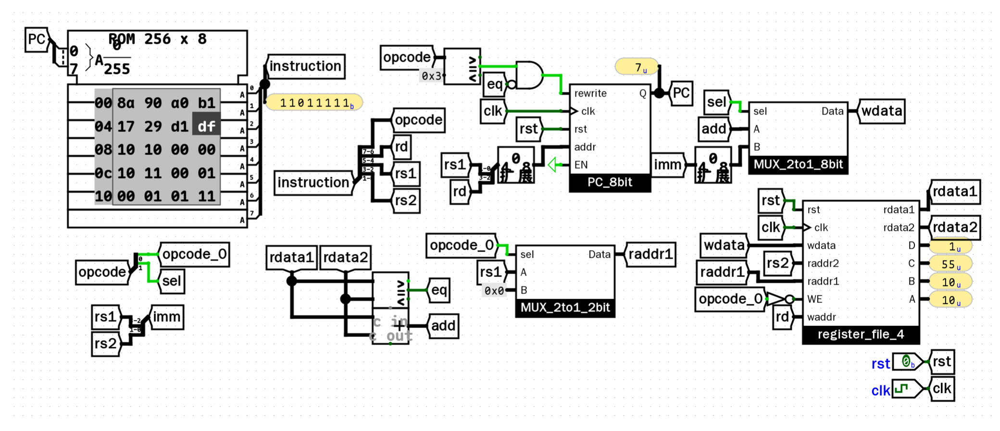

本文记录在 Logisim 中自底向上搭建数字电路的过程：从 MOS 管开关模型出发，推导 CMOS 门电路与门延迟，再到组合逻辑、时序部件，最终整合成一个能执行机器码程序的极简处理器（sCPU）。

## 1. 电平表示与 MOS 管开关模型

数字电路里的 0 和 1 本质上是电压的高低：0V 对应逻辑 0，电源电压 VDD 对应逻辑 1。控制电平切换的核心元件是 MOSFET，在逻辑设计中可以直接把它看作受电压控制的开关。

### 1.1 nMOS 与 pMOS 的开关特性

MOS 管有栅极（Gate）、源极（Source）和漏极（Drain）三个端。

在 Logisim 中，MOS 管位于 `Wiring` 元件库下的 `Transistor` 组件，通过属性面板的 `Type` 可以在 P-Type 与 N-Type 之间切换：


| 类型 | 导通条件 | 导通特性 | 电气局限 |
| :--- | :--- | :--- | :--- |
| **nMOS** | Gate 为高电平（1） | 漏极与源极导通 | 传低电平无衰减；传高电平存在阈值电压损失（最高约为 $V_{DD} - V_{th}$） |
| **pMOS** | Gate 为低电平（0，带小圆圈） | 漏极与源极导通 | 传高电平无衰减；传低电平存在阈值电压抬升（最低约为 $\lvert V_{th} \rvert$） |

单一类型的 MOS 管无法在全电压范围内完整传递信号，因此现代数字电路采用互补对称的 CMOS 结构：
- **上拉网络**：由 pMOS 构成，接电源 VDD，负责在输出为 1 时拉出高电平；
- **下拉网络**：由 nMOS 构成，接地线 GND，负责在输出为 0 时拉低到地。

在稳态下，上拉网络与下拉网络互斥导通，电源与地之间不存在直流通路，因此 CMOS 的静态功耗极低。

---

## 2. 基础门电路实现

### 2.1 非门（NOT）

非门（反相器）由 1 个 pMOS 和 1 个 nMOS 串联组成。输入同时接入两管栅极，输出取自两管相连的漏极：


在 Logisim 中搭建并验证其导通路径：
- **输入为 0**（左图）：pMOS 导通，nMOS 截止，输出被上拉到电源 VDD（1）；
- **输入为 1**（右图）：pMOS 截止，nMOS 导通，输出被下拉到地 GND（0）。


Logisim“分析电路”提取的真值表：


### 2.2 与非门（NAND）与 与门（AND）

在 CMOS 工艺中，反相逻辑（NAND、NOR）天然比同相逻辑（AND、OR）更简单。

与非门（NAND）只需要 4 个晶体管：
- **上拉网络**：2 个 pMOS 并联至电源。只要任一输入为 0，上拉通路就导通输出 1；
- **下拉网络**：2 个 nMOS 串联至地线。必须两个输入全为 1，下拉通路才导通输出 0。


在 Logisim 中搭建与非门并验证真值表：


而与门（AND）并不是原生 CMOS 单元，它其实是在与非门后面串接了一个由 1 个 pMOS 和 1 个 nMOS 组成的反相器，共需 6 个晶体管：


在 Logisim 中搭建与门并验证真值表：


因为多了一级反相器，与门不仅多占晶体管面积，还额外增加了一级门的传播延迟。

### 2.3 或非门（NOR）与 或门（OR）

或非门（NOR）与与非门的结构对偶，同样只需 4 个晶体管：
- **上拉网络**：2 个 pMOS **串联**至电源。必须两个输入全为 0，上拉通路才导通输出 1；
- **下拉网络**：2 个 nMOS **并联**至地线。只要任一输入为 1，下拉通路就导通输出 0。


在 Logisim 中搭建或非门并验证真值表：


类似地，硬件中没有原生或门（OR），它是在或非门后面级联一个反相器，共需 6 个晶体管：


在 Logisim 中搭建或门并验证真值表：


### 2.4 传输门（Transmission Gate）

传输门由 1 个 nMOS 与 1 个 pMOS 并联构成，由一对互补信号驱动：


在 Logisim 中搭建并验证其特性：


- **控制端 $c = 1$ 时（导通）**：下管 nMOS 接高电平导通，上管 pMOS 接低电平导通。此时输出端 $b$ 跟随输入端 $a$（$a=0 \rightarrow b=0$，$a=1 \rightarrow b=1$），nMOS 负责传低电平，pMOS 负责传高电平，两路互补无衰减；
- **控制端 $c = 0$ 时（截止）**：两管均截止，输出端呈高阻态（真值表显示为 `-`，导线呈深蓝色悬空状态）。

传输门适合搭建选择器和锁存器，能大幅精简晶体管用量。

### 2.5 异或门（XOR）

异或逻辑为输入相异输出 1，相同输出 0（$A \oplus B$）。

#### 门电路级方案对比
如果直接用基础门电路拼装，有几种常见思路：

1. **标准与或式（22 管）**：  
   根据布尔表达式 $C = (A \cdot \overline{B}) + (\overline{A} \cdot B)$ 搭建，需要 2 个非门、2 个与门和 1 个或门：
   
   
   
   晶体管开销：$2 \times 2(\text{NOT}) + 2 \times 6(\text{AND}) + 6(\text{OR}) = 22$ 管。

2. **OR + NAND + AND 方案（16 管）**：  
   按“至少一个为 1 且不同时为 1”写出 $C = (A + B) \cdot \overline{A \cdot B}$，用 1 个或门、1 个与非门和 1 个与门拼装：
   
   
   
   晶体管开销：$6(\text{OR}) + 4(\text{NAND}) + 6(\text{AND}) = 16$ 管。

3. **双 NOR + AND 方案（14 管）**：  
   用德摩根定律转化成 $C = \overline{\overline{A + B} + (A \cdot B)}$，需要 2 个或非门和 1 个与门：
   
   
   
   晶体管开销：$2 \times 4(\text{NOR}) + 6(\text{AND}) = 14$ 管。

#### 晶体管级全定制实现（6 管）

在晶体管层级，利用反相器和传输门可以大幅压缩器件数量：


在 Logisim 中搭建并验证：


工作原理：
- **左侧反相器（P1 + N1）**：输入信号 $A$，产生反相信号 $\overline{A}$；
- **右侧传输门（P3 + N3）**：受 $A$ 与 $\overline{A}$ 控制：
  - 当 $A = 0$（$\overline{A} = 1$）时传输门导通，直接把输入 $B$ 传到输出端（$C = B$）；
  - 当 $A = 1$ 时传输门截止；
- **中间互补对（P2 + N2）**：受输入 $B$ 控制：
  - 当 $A = 1$ 且 $B = 0$ 时，P2 导通把 $A$ 的高电平（1）送至输出；
  - 当 $A = 1$ 且 $B = 1$ 时，N2 导通把 $\overline{A}$ 的低电平（0）送至输出；
  - 即在 $A = 1$ 时输出 $C = \overline{B}$。

整电路仅需 **6 个晶体管**，面积比门级方案节省了一大半，输出完全符合异或真值表。

---

## 3. 门延迟（Propagation Delay）与竞争冒险（Glitch）

布尔代数中 $A \land \neg A$ 恒为 0，但在物理电路上，信号穿过门电路需要物理响应时间，即传播延迟（Propagation Delay）。

如果把信号 $A$ 分为两路接入与门：一路直连，另一路经过非门。当 $A$ 由 0 跳变到 1 时：
1. 直连路径几乎瞬间变为 1；
2. 非门路径因为存在延迟，输出在极短时间内仍然保持原来的 1；
3. 在这个瞬间窗口里，与门两个输入同时为 1，输出端就会冒出一个极窄的高电平脉冲（$0 \rightarrow 1 \rightarrow 0$）。

这种因路径延迟差导致的瞬态错误毛刺称为 **Glitch（竞争冒险）**。

在 Logisim 中可以通过单步模式复现：
- 按 `Ctrl+E` 暂停自动仿真；
- 修改输入信号电平；
- 按 `Ctrl+I` 单步推进一个门延迟时间步，能清楚看到信号沿导线逐步推进、Glitch 产生及消除的过程。

---

## 4. 组合逻辑电路搭建

### 4.1 2-4 译码器（Decoder）

译码器的作用是将 $n$ 位二进制输入（通常代表地址）转换为 $2^n$ 位独热码（One-hot）输出：输入值为几，对应索引的输出位为 1，其余全为 0。

2 位输入 $a[1..0]$ 与 4 位输出 $x[3..0]$ 的逻辑表达式为：
- $x[0] = \overline{a[1]} \cdot \overline{a[0]}$
- $x[1] = \overline{a[1]} \cdot a[0]$
- $x[2] = a[1] \cdot \overline{a[0]}$
- $x[3] = a[1] \cdot a[0]$

电路需要 2 个非门（4 管）与 4 个与门（24 管），共消耗 28 个晶体管。译码器的输出端数量和与门规模随输入位宽呈 $2^n$ 指数增长。

在 Logisim 中使用 `Wiring -> Splitter`（分线器）搭建：


- 输入端用 `Splitter` 将 2 位总线 $a[1..0]$ 拆成第 0 位与第 1 位；
- 经 2 个反相器与 4 个与门生成 4 路信号；
- 输出端再次用 `Splitter` 汇聚为 4 位总线 $x[3..0]$；
- 真值表输出符合独热码特征（`00->0001`, `01->0010`, `10->0100`, `11->1000`）。

#### 走线优化：利用输入端取反极性（Negate）
在 Logisim 中，逻辑门元件原生支持配置输入端的极性：
- 选中与门，在属性面板中配置对应引脚为取反极性（端点会出现小圆圈）；
- 这样输入母线可以直接直连各与门，省略外部反相器器件，画布走线更清晰：


该电路可直接封装为子电路（Subcircuit），作为后续模块的基础单元。

### 4.2 译码器的扩展：从 2-4 到 3-8 译码器

如果用两个 2-4 译码器拼装 3-8 译码器，必须引入使能端（Enable，`EN`）。否则两个 2-4 译码器同时工作，输出会出现两个 1，破坏独热码约束。

#### 带使能控制的 2-4 译码器封装
利用 Logisim 多位宽逻辑门的特性：
- 内部原有的 `decoder_2to4` 保持不变；
- 在 4 位输出总线上串接一个 **4 位宽与门**；
- 1 位使能信号 `EN` 经由 `Wiring -> Bit Extender` 扩充为 4 位，与译码结果做按位与：
  - `EN = 1` 时正常输出译码结果；
  - `EN = 0` 时输出被强制清零封锁。


#### 3-8 译码器的级联组装
将 3 位输入 $a[2..0]$ 分工：
- 低两位 $a[1..0]$ 同时连入两个 `decode_2to4_en` 子模块；
- 最高位 $a[2]$ 作为片选信号（Chip Select）：反相后接入低位子模块的 `EN`，直连接入高位子模块的 `EN`；
- 两组 4 位输出总线经 `Splitter` 汇聚为 8 位总线 $x[7..0]$。


真值表显示，从 `000` 到 `111`，8 位输出中的 1 从最低位依次移至最高位，满足 3-8 独热码规范。

#### 补充说明：CMOS 芯片中的电源门控（Power Gating）
在逻辑设计中，失能是通过与门将输出置 0 实现的。在实际集成电路物理设计中，使能控制还可以进一步下沉到晶体管层面：在下拉 nMOS 网络与地线（GND）之间串联一个共用的总开关管（Sleep Transistor 或 Foot Switch）。当 `EN = 0` 时断开开关，不仅使逻辑输出失能，还直接切断静态漏电通路，达到超低功耗关断（Power Gating）的效果。

### 4.3 七段数码管译码器（7-Segment Decoder）

七段数码管由 7 个条形发光二极管（a 到 g）排成“8”字型，另附 1 个小数点二极管（h）。其功能是将 4 位二进制输入解析为驱动各段亮灭的控制信号。

显示规范如下：
- 当输入为 0 到 9 时：正常点亮对应数字，小数点 h 保持熄灭；
- 当输入超出十进制范围（10 到 15 / `0xA` 到 `0xF`）时：显示段 a 到 g 全部熄灭，仅点亮小数点 h。

为了避免直接针对 4 位输入列写庞大的组合逻辑，采用两级架构：
1. **第一级**：调用 4-16 译码器（`decoder_4to16`），将 4 位输入展开为 16 根独热码信号线（0 到 15）；
2. **第二级**：采用矩阵式（PLA 风格）布线，设置 8 个或门分别对应 a 到 h 共 8 个控制端。各段所需点亮的独热码线引出节点汇入对应或门。


测试现象：
- 输入为 `1000`（十进制 8）时，第 8 根独热码线导通，驱动 a 到 g 七个或门全输出高电平，数码管显示数字“8”，小数点 h 熄灭；
- 输入在 10 到 15 范围时，总线将这六根信号导向底部的 h 或门，输出高电平点亮右下角小数点，其余段熄灭。

#### 扩展：支持十六进制显示（0 到 F）

扩展该译码器，使其在输入 10 到 15 时显示十六进制字符 `A`、`b`、`C`、`d`、`E`、`F`。为避免与数字 `8` 和 `0` 混淆，其中 `B` 与 `D` 约定采用小写形式显示。

改造点：
- 移除小数点 h 段，保留 a 到 g 七个主要段；
- 10 到 15 这 6 根独热码线分别接入对应字符所需点亮段的或门：
  - 10（A）：点亮 a, b, c, e, f, g
  - 11（b）：点亮 c, d, e, f, g
  - 12（C）：点亮 a, d, e, f
  - 13（d）：点亮 b, c, d, e, g
  - 14（E）：点亮 a, d, e, f, g
  - 15（F）：点亮 a, e, f, g


每个或门的输入端统一对齐为 16 通道交叉阵列（Crossbar）。测试输入为 `1010`（十进制 10）时，第 10 根独热码线导通，驱动 a、b、c、e、f、g 段点亮，底横 d 段熄灭，数码管显示大写字母 `A`。输入切换为其他数值时，各十六进制字符均能正常显示。

### 4.4 编码器（Encoder）与未定义输入处理

编码器是译码器的逆过程，用于将独热码输入还原为对应的二进制数值。例如在 4-2 编码器中，4 位输入 $a[3..0]$ 对应 2 位输出 $x[1..0]$：
- `0001`（第 0 位有效）输出 `00`
- `0010`（第 1 位有效）输出 `01`
- `0100`（第 2 位有效）输出 `10`
- `1000`（第 3 位有效）输出 `11`

在实际设计中，如何处理非独热码输入决定了硬件开销的差异：

#### 方案一：严格独热码检查（严格与或结构）
为了保证“只有合法的独热码才产生有效编码，其余输入一律置 0”，使用 4 输入与门配合输入端取反极性匹配每一路独热码：


- 现象：只有 `0001`、`0010`、`0100`、`1000` 产生对应的二进制输出，一旦输入包含多个 1（如 `0110`）或全 0，输出均被拦截置为 `00`；
- 开销：需要 3 个四输入与门与 2 个或门，等效晶体管开销在 120 个左右，规模随输入位宽膨胀迅速。

#### 方案二：利用无关项（Don't Care）化简的极简结构
如果引入设计假设——“输入严格为独热码，其余非法输入视为无关项 X”，布尔逻辑可大幅化简：
- $x[0]$ 只需在第 1 或第 3 位为 1 时拉高：$x[0] = a[1] + a[3]$
- $x[1]$ 只需在第 2 或第 3 位为 1 时拉高：$x[1] = a[2] + a[3]$

此时整个电路仅需 2 个简单的两输入或门：


- 现象：在合法独热码输入下功能完全正确，仅消耗 16 个晶体管（较方案一节省近 90% 面积）。但如果输入出现多路 1（例如按键冲突输入 `0110`），真值表显示输出会被错误计算为 `11`。

这种对非法输入的无能为力，直接促成了优先编码器（Priority Encoder）的采用：允许输入端同时有多个 1，由硬件按优先级自动裁决并编码最高位的 1。

### 4.5 4-2 优先编码器（Priority Encoder）

优先编码器用于解决多路信号同时触发时的仲裁问题：当输入中出现多个 1 时，永远仅对最高有效位（优先级最高）进行编码输出。在计算机体系结构中，该结构常用于中断控制器（Interrupt Controller）的多设备请求仲裁。

#### 逻辑推导
设定输入 $a[3..0]$ 中 $a[3]$ 拥有最高优先级，$a[0]$ 优先级最低：
- 若最高位 $a[3] = 1$，无论低位为何值，输出必须为 `11`；
- 仅当 $a[3] = 0$ 且 $a[2] = 1$ 时，第 2 位才能胜出输出 `10`（条件项为 $a[2] \cdot \overline{a[3]}$）；
- 仅当 $a[3] = 0$ 且 $a[2] = 0$ 且 $a[1] = 1$ 时，第 1 位才能胜出输出 `01`（条件项为 $a[1] \cdot \overline{a[2]} \cdot \overline{a[3]}$）；
- 若仅 $a[0] = 1$ 或全 0，输出为 `00`。

根据上述条件，输出两位的布尔逻辑为：
- $x[1] = a[3] + (a[2] \cdot \overline{a[3]}) = a[3] + a[2]$
- $x[0] = a[3] + (a[1] \cdot \overline{a[2]} \cdot \overline{a[3]})$

#### 电路搭建与仿真
在 Logisim 中，利用输入端取反极性精简布线：


- **电路结构**：仅需 1 个三输入与门、1 个两输入与门和 2 个或门。由于 $a[0]$ 的有效状态对应输出 `00`，且其本身无法压制任何高位，因此 $a[0]$ 在门级网络中无需物理连线即可满足真值表要求；
- **真值表特征**：右侧分析表格展现了优先编码器的阶梯屏蔽效果：只要 $a[3] = 1$（第 8 到 15 行），无论低三位如何组合，输出恒为 `11`；当 $a[3] = 0$ 且 $a[2] = 1$（第 4 到 7 行），输出恒为 `10`。各输入组合均严格按最高优先级导通。

### 4.6 多路选择器（MUX）

多路选择器根据选择端 $S$ 的电平状态，从多路输入数据中择一选通至输出端 $Y$。

以 1 位 2 选 1 选择器（2-1 MUX）为例，其功能定义为：
- 当 $S = 0$ 时：输出 $Y = A$
- 当 $S = 1$ 时：输出 $Y = B$

#### 方案一：标准门电路实现（与或结构，26 管）

布尔表达式为 $Y = (\overline{S} \cdot A) + (S \cdot B)$。使用 1 个非门生成互补选择信号，分别门控两路数据输入，最后通过或门汇聚：


在 Logisim 中搭建并验证：


- 硬件开销：包含 1 个非门（2 管）、2 个与门（12 管）和 1 个或门（6 管），等效消耗约 20 到 26 个晶体管；
- 实测真值表：当 $S=0$ 时，前 4 行输出跟随输入 $A$；当 $S=1$ 时，后 4 行输出跟随输入 $B$。

#### 方案二：传输门全定制实现（仅 6 管）

利用传输门作为双向模拟开关的特性，可以直接控制数据路径的物理通断：


在 Logisim 中搭建并验证：


- **工作机制**：
  - 由 1 个反相器将选择信号 $S$ 反相产生 $\overline{S}$；
  - 上方传输门（连接输入 $A$）由 $\overline{S}$ 控制：当 $S=0$（$\overline{S}=1$）时导通，将 $A$ 送至输出端 $Y$；
  - 下方传输门（连接输入 $B$）由 $S$ 控制：当 $S=1$（$\overline{S}=0$）时导通，将 $B$ 送至输出端 $Y$；
  - 两路传输门互斥导通，确保任意时刻仅有一路数据驱动输出端；
- **开销优势**：仅需 1 个反相器（2 管）+ 2 个传输门（4 管）= **共 6 个晶体管**，相比门级方案面积缩小了近 80%，实测真值表与门级方案完全等价。

#### 扩展：3 位 4 选 1 选择器（传输门二叉树拓扑）

针对 3 位 4 选 1 选择器，采用两级二叉树结构（MUX Tree）搭建：
- **两级二叉树拓扑**：
  - 第一级（左侧）：由低位选择信号 $S[0]$ 及其反相信号并行控制两组 MUX。上半区负责在输入 A（`001`）与输入 B（`010`）之间抉择；下半区负责在输入 C（`110`）与输入 D（`111`）之间抉择，各自输出一组 3 位中间总线；
  - 第二级（右侧）：由高位选择信号 $S[1]$ 及其反相信号控制最终的 MUX，在两组中间总线之间完成最终裁决；
- **总线通道实现**：每一位数据均独立分配一个互补传输门，通过 `Splitter` 进行 3 位总线的分线与汇聚。


- **硬件开销**：整个 3 位 4 选 1 电路包含 2 个 CMOS 反相器（4 管）+ 第一级 12 个传输门（24 管）+ 第二级 6 个传输门（12 管）= **仅消耗 40 个晶体管**。若采用门电路方案（2-4 译码器 + 3 组四输入与或门），晶体管开销将超过 130 个；
- **实测验证**：当前选择信号置为 `11`（选择通道 D），第一级选出输入 D（`111`），第二级将该数据送至输出端 Y，最终输出端输出 `111`。

### 4.7 比较器（Comparator）

比较器用于判断两个多位二进制数据是否全等，在处理器中主要负责条件分支跳转指令（如 RISC-V 的 `beq` / `bne`）的相等性裁决。

#### 逻辑推导与电路拓扑
两数完全相等意味着每一位对应数值完全一致：
- **单比特判等**：使用同或门（XNOR）。当且仅当两位取值相同时（同为 0 或同为 1），输出 1；
- **全等聚合**：将每一位同或门的输出汇总接入一个多输入与门。当且仅当每一位全部匹配时，与门输出 1。


#### 硬件开销评估
- 4 位比较器：4 个同或门（$4 \times 6 = 24$ 管）+ 1 个四输入与门（24 管）= 48 个晶体管；
- 32 位比较器：32 个同或门与 32 输入多级与门，开销线性扩展至约 440 个晶体管。

#### 方案一：XNOR + AND 结构（同或逐位判等）

布尔表达式为 $Y = \overline{A_3 \oplus B_3} \cdot \overline{A_2 \oplus B_2} \cdot \overline{A_1 \oplus B_1} \cdot \overline{A_0 \oplus B_0}$：


- 两路输入总线经 `Splitter` 分离后，第 0 到 3 位分别接入 4 个 XNOR 门的输入端；
- 测试两组输入均置为 `0110`（十进制 6）：各位数值相同，4 个 XNOR 输出全为 1；四输入与门导通，输出高电平 1。若任意一位出现差异，对应 XNOR 输出跌为 0，与门输出翻转为 0。

#### 方案二：XOR + NOR 结构（异或求异 + 或非归零）

利用德摩根定律，判等逻辑可转化为对偶结构：
$$Y = \overline{(A_3 \oplus B_3) + (A_2 \oplus B_2) + (A_1 \oplus B_1) + (A_0 \oplus B_0)}$$


- **工作机制**：前级改用 4 个异或门（XOR）检测差异——若某一位不同则输出 1，完全相同则输出 0；后级接入一个 4 输入或非门（NOR4）；
- **实测验证**：输入同为 `0110` 时，4 个 XOR 门全部输出低电平 0；四输入或非门在全 0 输入下输出高电平 1；
- **工艺优势**：在 CMOS 物理设计中，NOR 是原生反相逻辑单元（4 管下拉并联），相比需要后级反相的与门（AND = NAND + NOT），该对偶方案门延迟更小，晶体管开销也更低。

### 4.8 加法器（Adder）：从半加器到全加器

加法是计算机算术逻辑单元（ALU）的基础。多位加法器由底层的全加器级联构成，而全加器又可由半加器拼装而成。

#### 1 位半加器（Half Adder）
半加器用于计算两个 1 位二进制数的加法，不考虑低位传入的进位信号。
- **逻辑定义**：
  - 本位和 $S = A \oplus B$（异或运算）
  - 进位输出 $C_{out} = A \cdot B$（与逻辑）
- **电路复用设计**：在具体搭建时，可以直接复用前面的双 NOR + AND 异或门结构。由于该异或结构内部天然包含一个计算 $A \cdot B$ 的与门，因此进位端 $C_{out}$ 可以直接从该与门节点引出，无需额外增加任何门电路器件：


- **实测验证**：当前输入置为 $A=1, B=1$，本位和 $S$ 输出 0，进位端 $C_{out}$ 输出 1，代表二进制结果 `10`（十进制 2）。

#### 1 位全加器（Full Adder）
全加器引入了低位进位输入 $C_{in}$，用于计算 3 个单比特的算术和（$A + B + C_{in}$），输出本位和 $S$ 与向高位的进位输出 $C_{out}$。

通过两级半加器级联实现全加器：
- 第一级半加器完成 $A + B$，输出中间和 $S_0 = A \oplus B$ 与中间进位 $C_0 = A \cdot B$；
- 第二级半加器接收 $S_0$ 与低位进位输入 $C_{in}$，输出最终本位和 $S = S_0 \oplus C_{in} = A \oplus B \oplus C_{in}$ 与第二级进位 $C_1 = S_0 \cdot C_{in}$；
- 最终进位输出为 $C_{out} = C_0 + C_1$。由于两级半加器不可能同时产生进位，因此直接使用一个或门将两路进位汇聚即可。


- **实测验证**：输入置为三输入全高 $A=1, B=1, C_{in}=1$：第一级输出中间和 0、中间进位 1；第二级接收中间和 0 与 $C_{in}=1$，输出本位和 $S=1$；末级或门汇聚第一级进位，输出最终进位 $C_{out}=1$；输出 $S=1, C_{out}=1$，代表二进制数值 `11`（十进制 3）。

---

#### 4 位行波进位加法器（Ripple-Carry Adder, RCA）

将多个 1 位全加器串行级联，低位的进位输出 $C_{out}$ 直接驱动相邻高位的进位输入 $C_{in}$。进位信号自最低位向最高位逐级传递，称为行波进位加法器（RCA）。


在 Logisim 中实例化 4 个 `full_adder_1bit` 子电路搭建：


- **电路拓扑**：
  - 两路 4 位输入总线 $A[3..0]$ 与 $B[3..0]$ 经 `Splitter` 拆解为单线，送入 4 个全加器对应的 $A$ 与 $B$ 端口；
  - 最低位全加器接收外部进位输入 $C_{in}$；
  - 进位链依次串联：第 0 位 $C_{out} \rightarrow$ 第 1 位 $C_{in} \rightarrow$ 第 2 位 $C_{in} \rightarrow$ 第 3 位 $C_{in}$；
  - 最高位进位输出作为整组加法器的 $C_{out}$，各级和信号 $S$ 汇聚为 4 位总线 $S[3..0]$。
- **实测验证**：
  - 测试输入设定为：$A = 1110_b$（十进制 14）、$B = 0110_b$（十进制 6）、$C_{in} = 1_b$（十进制 1）；
  - 理论运算值：$14 + 6 + 1 = 21 = 16 + 5 = 1 \times 2^4 + 0101_b$；
  - 实测输出端：4 位和总线 $S$ 输出 `0101`（5），高位进位端 $C_{out}$ 输出 `1`（权值为 16），合成结果等于 21。
- **性能与时序瓶颈**：
  - 行波进位加法器的关键路径（Critical Path）由进位链决定。当位宽为 $N$ 时，最高位必须等待前 $N-1$ 级进位依次结算完成才能获得稳定输出，运算延迟与位宽成正比（$O(N)$）。在高性能处理器设计中，为了打破该延迟链条，通常会采用超前进位加法器（Carry-Lookahead Adder, CLA）。

### 4.9 补码原理与加减法一体化电路

在计算机硬件设计中，无需为减法单独开辟减法器硬件电路。利用二进制补码的数学性质，减法运算 $A - B$ 可以等价转化为加法：
$$A - B = A + (-B)$$

根据补码定义，负数 $-B$ 的补码表示为其按位取反加 1（即 $-B = \overline{B} + 1$）。代入可得：
$$A - B = A + \overline{B} + 1$$

利用该恒等式，只需在加法器的基础上增加控制逻辑，即可实现“加减法一体化”：
- **操作数取反选择**：使用一个多路选择器 MUX（或异或门）受控于模式选择信号 `sub`。当 `sub = 0`（加法模式）时透传原码 $B$；当 `sub = 1`（减法模式）时透传取反后的 $\overline{B}$；
- **末位补 1**：将控制信号 `sub` 直接接入加法器最低位的进位输入端 $C_{in}$。在减法模式下，`sub = 1` 自动将最低位进位拉高，完成最后的 $+1$ 操作。

在 Logisim 中使用 4 位 2-1 MUX 搭建加减法一体化电路：


实测减法运算：
- 输入设置：被减数 $A = 1110_b$（十进制 14），减数 $B = 0110_b$（十进制 6），控制信号 `sub = 1`（启动减法模式）；
- 运算推导：
  $$\overline{B} = \overline{0110_b} = 1001_b \quad (9)$$
  $$A + \overline{B} + C_{in} = 14 + 9 + 1 = 24 = 16 + 8$$
  截断第 4 位进位（$C_{out} = 1$，权重为 16）后，低 4 位结果为 8（`1000_b`）；
- 实测输出：和总线 $S$ 输出 `1000`（十进制 8），$C_{out}$ 输出 1（在无符号数减法中 $C_{out}=1$ 表示无借位，即 $A \ge B$），验证了 $14 - 6 = 8$ 的硬件计算。

### 4.10 补码溢出检测（Overflow Detection）

4 位有符号补码的数值表示范围为 $[-8, +7]$。当运算结果超出该区间时，即发生溢出（Overflow），导致符号位错乱。

#### 数学定义到硬件逻辑的映射推导
数学上判断溢出的规则为“同号相加产生异号结果”（正正得负或负负得正，异号相加绝不溢出）。

若直接根据符号位搭建判断电路：
$$\text{Overflow} = (\overline{A_3} \cdot \overline{B_3} \cdot S_3) + (A_3 \cdot B_3 \cdot \overline{S_3})$$
而在硬件实现中，考察最高位（符号位）全加器的物理进位关系：
- 本位和：$S_3 = A_3 \oplus B_3 \oplus C_{in3}$
- 进位输出：$C_{out3} = (A_3 \cdot B_3) + (A_3 + B_3) \cdot C_{in3}$

将三类符号输入情况代入分析：
1. **异号相加（$A_3 \neq B_3$）**：此时 $A_3 \cdot B_3 = 0$ 且 $A_3 + B_3 = 1$，代入可得 $C_{out3} = C_{in3}$，恒有 $C_{in3} \oplus C_{out3} = 0$（绝不溢出）；
2. **同为正数（$A_3 = 0, B_3 = 0$）**：进位输出必定 $C_{out3} = 0$，且 $S_3 = C_{in3}$。正正得负的溢出条件为 $S_3 = 1$，即充要条件为 $C_{in3} = 1$。此时 $C_{in3} \neq C_{out3}$；
3. **同为负数（$A_3 = 1, B_3 = 1$）**：进位输出必定 $C_{out3} = 1$，且 $S_3 = C_{in3}$。负负得正的溢出条件为 $S_3 = 0$，即充要条件为 $C_{in3} = 0$。此时 $C_{in3} \neq C_{out3}$。

综合可知，溢出的充分必要条件可极简表示为最高位的进位输入与进位输出异或：
$$\text{Overflow} = C_{in3} \oplus C_{out3}$$

其物理本质在于：$C_{in3}$ 是低位数值区向符号位灌入的进位，而 $C_{out3}$ 是符号位自身向外排出的进位。当两者不一致时（仅进不出或仅出不进），符号位必然被非法改写。

#### 电路搭建与实测

在 4 位加减法器的最高位全加器旁，引出进位输入 $C_{in3}$ 与进位输出 $C_{out3}$ 接入 1 个异或门：


实测用例分析：
- 设定输入：两组 4 位有符号正数加法，$A = 0101_b$（十进制 $+5$），$B = 0110_b$（十进制 $+6$），控制信号 `sub = 0`（加法模式）；
- 理论运算值：$(+5) + (+6) = +11$，超出了 4 位有符号补码上限 $+7$，必然引发正溢出；
- 实际输出结果：4 位和总线 $S$ 输出 `1011_b`（符号位被错误篡改为 1，在补码中被解释为 $-5$），呈现出“正正得负”异常；
- 溢出检测逻辑响应：低位数值区向符号位灌入进位 $C_{in3} = 1$，而符号位本身并无进位排出（$C_{out3} = 0$）。异或门计算 $1 \oplus 0 = 1$，输出端 `Overflow` 输出高电平 `1`，捕获并告警了该溢出事件。

---

## 5. 时序逻辑电路与状态存储

组合逻辑电路的输出完全由即时输入决定，不具备记忆能力。为了构建能够运行程序的计算机系统，电路必须能够“保持旧状态”并在受控时“写入新状态”。具备状态保持特性的电路称为时序逻辑电路。

### 5.1 状态保持的雏形：正反馈闭环

电路能够“记住”1 位信息的基础物理拓扑是**交叉配对反相器**：将两个非门首尾相连形成正反馈回路。


- 若一侧节点为 0，经非门反相后另一侧为 1；该 1 反馈至原节点，继续维持 0；
- 只要持续供电，该闭环即可稳定维持 0 或 1 两种稳态之一。

然而，纯粹的双非门闭环没有任何外部控制输入，外部逻辑无法对其写入新状态。

### 5.2 SR 锁存器（S-R Latch）

为了引入写入控制能力，将闭环中的非门替换为**或非门（NOR）**，并向外引出控制引脚：
- **$S$（Set）**：置位输入端，用于将输出写入 1；
- **$R$（Reset）**：复位输入端，用于将输出清为 0；
- **$Q$ 与 $\overline{Q}$（`nQ`）**：两个互补的输出端。


#### 工作状态分析
利用或非门“任一输入为 1 输出即被拉低至 0”的特性，电路行为分为四种状态：
1. **置位（$S=1, R=0$）**：$S=1$ 强制使下方或非门输出 $\overline{Q} = 0$；此时上方或非门两个输入均为 0，输出端 $Q$ 被拉高至 1，完成存入 1；
2. **保持（$S=0, R=0$）**：撤销置位信号回到全 0。此时两个或非门依靠内部正反馈继续维持 $Q=1$ 和 $\overline{Q}=0$，输出端保持上一刻的状态不变，体现出记忆能力；
3. **复位（$S=0, R=1$）**：$R=1$ 强制使上方或非门输出 $Q = 0$；下方或非门两个输入均为 0，输出 $\overline{Q} = 1$，完成存入 0；
4. **禁止状态（$S=1, R=1$）**：两或非门输出同时被强行拉低为 0，破坏了互补关系。若输入随后瞬间跳变回 $00$，两侧竞争将导致电路陷入不可预测的亚稳态或振荡。

#### Logisim 搭建与实测

在 Logisim 中使用 2 个两输入或非门搭建交叉反馈网络：


实测验证：
- 当前输入设置为置位状态 $S=1, R=0$：下方或非门被激活，输出端 $Q$ 稳定输出高电平 1，反相端 $nQ$ 输出低电平 0；
- 随后将 $S$ 拨回 0（形成 $S=0, R=0$）：电路依然维持在 $Q=1$，验证了断开激励后的状态保持能力；
- 若使用 Logisim 静态“分析电路”工具，在 $S=0, R=0$ 处会标记冲突错误。这是因为在静态真值表中输出必须是当前输入的确定函数，而时序电路在 $00$ 输入下的输出由历史状态决定，纯组合逻辑分析器无法得出唯一值，从工具层面印证了时序记忆特性的物理本质。

### 5.3 D 锁存器（D Latch）

SR 锁存器需要同时操作 $S$ 和 $R$ 两个控制端，且误输入 $S=1, R=1$ 会引发非法振荡。

D 锁存器通过在前级增加门控逻辑解决了该问题，将接口精简为两个直观的引脚：
- **数据端 $D$（Data）**：期望存入的数值（0 或 1）；
- **写使能端 $WE$（Write Enable）**：控制是否允许写入。


#### 门控逻辑分析
前级由 2 个与门和 1 个非门构成控制通路：
- 数据信号 $D$ 直接接入置位通路的与门，经反相后接入复位通路的与门；
- 写使能信号 $WE$ 同时连接两个与门的使能端。

工作机制分两种工况：
1. **写保护/锁存状态（$WE = 0$）**：两与门输出均被强制钳位为 0（即 $S=0, R=0$）。无论外部输入 $D$ 如何变动，后级 SR 锁存器保持原有状态不变，电路完成数据锁存。
2. **写入状态（$WE = 1$）**：两与门导通，两路信号互补：
   - 当 $D = 1$ 时：$S = 1, R = 0$，后级被置位，输出 $Q$ 翻转为 1；
   - 当 $D = 0$ 时：$S = 0, R = 1$，后级被复位，输出 $Q$ 翻转为 0。
   输出端 $Q$ 实时跟随输入端 $D$（透明传输）。

硬件优势在于：由于置位与复位端分别接收 $D$ 与 $\overline{D}$，在物理结构上完全排除了 $S=1, R=1$ 同时成立的可能，消除了非法输入风险。

#### 方案一：基于 SR 锁存器的门控实现（30 管）

在 Logisim 中使用已封装的 `SR_latch` 子模块搭建基础 D 锁存器：


实测验证：
- 设置写使能 $WE = 1$（开启写入），数据端输入 $D = 1$；
- 复位通路输出 0，置位通路输出 1，驱动 `SR_latch` 的 $S$ 端置高，输出端 $Q$ 写入高电平 1；
- 一旦将 $WE$ 拨回 0，两路控制线被封死为 00，输出端 $Q$ 即被锁定，不再受输入端 $D$ 后续变动的影响。

#### 方案二：传输门全定制实现（仅 10 管）

在芯片物理设计（如 SRAM 单元）中，为了削减晶体管数量，广泛采用传输门（TG）构建全定制 D 锁存器：


工作机制：
- **写入状态（$WE = 1$）**：下方传输门导通，新数据 $D$ 直通内部节点；上方传输门关断，**切断正反馈回路**，避免新旧电平发生短路冲突。此时 $Q = D$，$\overline{Q} = \overline{D}$。
- **锁存状态（$WE = 0$）**：下方传输门关断，切断与外部数据的连接；上方传输门导通，**闭合两个反相器的正反馈回路**，形成双稳态正反馈，锁定数据。
- **开销优势**：仅需 3 个反相器（6 管）+ 2 个传输门（4 管）= **仅消耗 10 个晶体管**，相比门级方案（约 30 管）节省了 66% 以上的芯片面积。

在 Logisim 中搭建并验证该全定制传输门 D 锁存器：

1. **写入 0 状态（$WE = 1, D = 0$）**：


- 下方传输门导通送入低电平，输出端呈现 $Q = 0$、反相端呈现 $nQ = 1$。

2. **写入 1 状态（$WE = 1, D = 1$）**：


- 下方传输门导通送入高电平，输出端呈现 $Q = 1$、反相端呈现 $nQ = 0$。上方传输门在写入期间保持截止，隔离反馈回路。

#### 电平触发的局限性
D 锁存器属于 **电平触发**（Level-triggered）器件，也被称为透明锁存器。在 $WE = 1$ 保持高电平的整个时间窗口内，数据端到输出端始终处于通路状态。

在 CPU 内部的闭环运算（例如计数器 `A = A + 1`）中，若使用电平触发锁存器，在使能信号维持高电平的微小周期内，数据将在加法器与锁存器之间发生无限次不受控的穿透累加。因此，同步时序系统需要一种仅在“时钟电平跳变的瞬间”采样的器件—— **边沿触发的 D 触发器**（D Flip-Flop）。

### 5.4 主从 D 触发器（Master-Slave D Flip-Flop）

为了实现仅在时钟边沿瞬间采样的特性，主从 D 触发器采用两级 D 锁存器串联架构（前级为主锁存器 Master，后级为从锁存器 Slave）：
- 时钟信号 $clk$ 经反相后控制主锁存器的使能端；
- $clk$ 直接控制从锁存器的使能端。

由于两级锁存器的使能极性完全相反，数据通路在任意稳态下均处于截断状态，消除了电平穿透问题。


#### 工作时序三阶段分析
1. **数据准备阶段（$clk = 0$）**：主锁存器接收 $\overline{clk} = 1$ 导通，数据输入 $D$ 进入主锁存器并抵达两级间的中间节点；从锁存器接收 $clk = 0$ 保持关闭，输出端 $Q$ 保持前一状态不变。
2. **时钟上升沿翻转瞬间（$clk$ 发生 $0 \rightarrow 1$ 跳变）**：主锁存器使能端 $\overline{clk}$ 跌落为 0 瞬间关闭落锁，封死外部输入 $D$；同时从锁存器使能端 $clk$ 跃升为 1 开启通道，中间等待区暂存的数据立即被推至输出端 $Q$ 与 $\overline{Q}$。
3. **维持阶段（$clk = 1$）**：主锁存器持续关闭，外部输入 $D$ 的任何变动均无法穿透；从锁存器保持输出稳定。

#### Logisim 搭建与实测

在 Logisim 中使用 2 个 `D_latch` 子模块与 1 个反相器搭建主从 D 触发器：

1. **时钟低电平准备阶段（$clk = 0$）**：


- 反相器输出高电平驱动主锁存器（$WE = 1$ 导通），输入数据 $D = 1$ 进入主锁存器并输出至两级间的中间节点（绿色高电平线）；
- 从锁存器接收 $clk = 0$ 处于关门锁存状态，阻断数据向外传播，输出端保持历史值（$Q = 0$）。

2. **时钟跳变为高电平更新阶段（$clk = 1$）**：


- 时钟上升沿到来时，主锁存器使能端变为 0 瞬间关闭落锁，阻断外部输入 $D$ 的后续变动；
- 同时从锁存器使能端跃升为 1 开启通道，中间级暂存的数值 1 被推入后级，输出端同步翻转更新为 $Q = 1$、$nQ = 0$；
- 在整个 $clk = 1$ 维持阶段，主锁存器持续关闭，外部输入 $D$ 无论如何跳变均无法穿透，实现了边沿触发的时钟同步特性。

#### 扩展功能实现

##### 1. Button 按钮产生时钟脉冲
在 Logisim 中使用 `Wiring -> Button` 元件作为时钟输入，点击一次按钮即可产生一个标准的 $0 \rightarrow 1 \rightarrow 0$ 单脉冲：


按下按钮瞬间产生上升沿，后级从锁存器开启并更新输出；按住按钮不松开期间，前级主锁存器持续锁死，此时变动数据端 $D$ 无法穿透至输出端，验证了主从两级的隔离特性。

##### 2. 带同步复位功能的 D 触发器
在数据输入端 $D$ 串接 1 个两输入与门，另一端接入反相后的复位信号（$D_{in} = D \cdot \overline{rst}$）：

1. **正常工作状态（$rst = 0$）**：


- 当 $rst = 0$ 时，$\overline{rst} = 1$，输入数据 $D = 1$ 原样送入主锁存器，时钟触发后正常写入 $Q = 1$、$nQ = 0$。

2. **复位生效状态（$rst = 1$）**：


- 当 $rst = 1$ 时，$\overline{rst} = 0$，无论外部数据 $D$ 为何值，与门输出均被强制钳位为 0。时钟脉冲到来时，触发器被同步清零为 $Q = 0$、$nQ = 1$。

##### 3. 位翻转功能与二分频（Toggle）
将反相输出端 $\overline{Q}$（`nQ`）通过带同步复位的与门反馈回数据输入端 $D$（即 $D_{in} = \overline{Q} \cdot \overline{rst}$）：


该电路构成了二进制计数器与时钟二分频器的核心原子单元：
- 当 $rst = 0$ 时：反相输出直接驱动输入，当前状态为 $Q = 0, nQ = 1$ 时，输入端等待的值为 1；每敲击一次时钟按钮，输出端便稳定翻转一次（$0 \rightarrow 1 \rightarrow 0 \rightarrow 1$）；
- 当 $rst = 1$ 时：前级与门强制切断反馈输入并写 0，可对翻转单元进行同步复位清零。

##### 4. 带使能端的 D 触发器（DFFE）
在实际处理器架构中，寄存器通常只在特定指令执行时才允许更新，绝大多数周期必须保持旧值不变。为了实现该功能，严禁直接在时钟线上串联门电路（门控时钟缺陷会引入严重的毛刺与时钟偏斜），工业界的标准做法是在数据端引入 2-1 MUX 构成反馈选通网络：


- **电路拓扑**：
  - 时钟信号 $clk$ 直连触发器时钟端；
  - 在数据输入端前级配置 1 个 2-1 MUX：通道 1 接收外部新数据 $D$，通道 0 接收输出端 $Q$ 自身的反馈回路，选择端由使能信号 $EN$ 控制。
- **工作机制**：
  - 当 $EN = 1$（使能写入）时：MUX 选通外部数据 $D$，时钟上升沿到来时正常采样并更新数据；
  - 当 $EN = 0$（保持封锁）时：MUX 选通输出端旧值 $Q$ 反馈回输入端。时钟边沿到来时对旧值重采样，输出 $Q$ 维持不变。
- **实测验证**：外部输入设置 $D = 1$，使能端置为 $EN = 0$（禁止写入）。即使时钟跃升为高电平（$clk = 1$），MUX 仍选通上方 $Q = 0$ 的反馈信号送入输入端，输出端稳定锁存在 $Q = 0$。

### 5.5 寄存器（Register）

单比特 D 触发器仅能暂存 1 bit 信息。在处理器内部，数据均以多位字（Word，如 4 位、8 位、32 位）为单位并行流转，将多个触发器并联组合，共享时钟与控制网络，即构成寄存器（Register）。寄存器是 CPU 通用寄存器组（GPR）与程序计数器（PC）的物理基础。


#### 电路拓扑与控制总线设计
在 Logisim 中使用 4 个内建使能与复位功能的 `D_flipflop_en` 子模块搭建标准 4 位寄存器：


- **总线分流与汇聚**：使用输入端 `Splitter` 将 4 位数据总线 $D[3..0]$ 分解为单比特信号，分别送入 4 个触发器的 $D$ 端口；各触发器的输出端 $Q$ 经由输出端 `Splitter` 重新汇集为 4 位总线 $Q[3..0]$。
- **全局控制信号分发**：
  - 时钟线 `clk` 构成树状直连网络，并行分发至每个触发器的时钟端口；
  - 复位线 `rst` 并行接入每个触发器的复位端，支持同步整字清零；
  - 写使能线 `EN` 并行接入每个触发器的使能端，支持受控整字写入。
- **实测验证**：输入设置数据总线 $D = 1110_b$（十进制 14），写使能置为 $EN = 1$，复位端保持 $rst = 0$。时钟脉冲触发后，4 位数据写入触发器，输出总线 $Q$ 稳定输出 `1110_b`。若将 $EN$ 拨回 0，输出端锁定在 `1110_b`，输入端总线后续变动不再干扰内部状态。

### 5.6 4 位计数器（Counter）

计数器是时序逻辑中具备状态递进能力的电路系统。在处理器架构中，程序计数器（Program Counter, PC）的顺序取指机制（$\text{PC} = \text{PC} + 1$ 或 $\text{PC} + 4$），本质上是一个受控自增的计数器。

#### 闭环自增架构设计
将时序存储元件与组合算术运算模块连接为反馈回路：
- **核心模块**：前面封装的 4 位寄存器（`register_4bit`）与 4 位加法器；
- **状态反馈**：寄存器的输出总线 $Q[3..0]$ 一路引向外部显示，另一路送入加法器的输入端 A；加法器输入端 B 连接常数 `0x1`（4 位宽）；
- **数据回灌**：加法器的和输出端（即数值 $Q + 1$）连回寄存器的数据输入总线 $D[3..0]$；
- **控制引脚**：写使能置为 $EN = 1$，复位端保持 $rst = 0$。

在 Logisim 中搭建闭环系统并连接数码管：

1. **计满最大值状态（显示字符 `F`，数值 15）**：


2. **自然回绕重置状态（显示字符 `0`，数值 0）**：


#### 二进制计数与数值解释（无符号数 vs 补码）
4 位二进制在加法器中逐拍递增：
`0000 -> 0001 -> ... -> 0111 (7) -> 1000 (8 / -8) -> ... -> 1111 (15 / -1) -> 0000`
- 加法器硬件本身仅执行纯粹的二进制模运算，不区分有符号或无符号；
- 若通过探针以有符号数格式查看，当计数达到 8 时符号位变为 1，会被显示为负数（$-8$ 到 $-1$）；而在无符号数或十六进制数码管中，则完整展现为连续递增的 `0` 到 `F`（0 到 15）。

#### 实测现象
开启时钟脉冲后，寄存器在每一拍上升沿捕获加法器的计算结果：
- 随着时钟脉冲推进，计数器运行至上限数值 15（`1111_b`），右侧数码管显示十六进制字符 **`F`**；
- 在下一个时钟周期，加法器执行 $15 + 1 = 16$ 产生高位进位输出 $C_{out} = 1$，4 位和总线低位发生截断重置为 `0000_b` 并写入寄存器，数码管更新显示为 **`0`**，验证了硬件计数器自动回绕（Wrap-around）循环运转的特性。

---

### 5.7 专用数列求和电路实战（1 加到 10）

不编写软件程序的条件下，仅通过门电路、寄存器与算术模块搭建专用硬件计算系统，完成等差数列累加计算：
$$1 + 2 + 3 + \dots + 10 = 55$$

#### 专用数据通路与控制逻辑设计
该系统由四个核心功能模块构成：
1. **项计数器 $i$（`counter_8bit`）**：由 8 位寄存器与加法器闭环构成，随全局时钟脉冲递增生成当前累加项序列（$1, 2, 3, \dots$）；
2. **累加加法器**：8 位全加器的两路输入分别连接累加寄存器的输出总线 $sum$ 与项计数器的输出总线 $i$，计算当前步骤的新累加和（$sum + i$）；
3. **累加寄存器（`register_8bit`）**：负责在每一拍时钟上升沿锁存累加和的新值，并将输出作为下一拍的基数反馈回加法器；
4. **终止判决逻辑（比较器）**：引入比较器将当前项 $i$ 与常数 `0x0b`（十进制 11）进行对比。当 $i < 11$（即 $i \le 10$）时，比较器输出高电平驱动累加寄存器的使能端 $EN = 1$ 进行采样；当 $i$ 达到 11 时，比较器输出拉低关闭写使能 $EN = 0$，将累加寄存器锁死在当前值，实现自动停机。

在 Logisim 中搭建系统并进行运算验证：


#### 实测现象
- 复位后启动仿真，时钟脉冲依次推进：累加项从 1 自增至 10，累加寄存器同步执行 $0 \rightarrow 1 \rightarrow 3 \rightarrow 6 \rightarrow 10 \rightarrow \dots \rightarrow 55$；
- 当计数器达到 11 时，比较器拉低写使能 $EN$，累加寄存器停止接收加法器输出，输出端 `sum` 停机并锁定在 **`55_s`**（十进制 55）。

---

### 5.8 电子时钟系统实战（24 小时制分秒级联走时）

在掌握了单个模 16 计数器与专用累加反馈之后，时序逻辑阶段的综合硬件任务是搭建一套 **24 小时制电子时钟系统**（显示格式：`HH : MM : SS`，范围 `00:00:00` $\sim$ `23:59:59`）。

系统由 6 个十进制/六进制计数单元和 6 个七段数码管构成，搭建过程中需解决以下设计问题：

#### 1. 架构抉择：行波时钟的缺陷与同步使能级联
若将低位计数器的进位脉冲直接接到高位计数器的时钟输入端（`clk`），构成行波时钟（Ripple Clock），存在两个隐患：
1. **时钟延迟与竞争毛刺**：时钟信号经过各级门电路逐级延迟累积，级联越多时序余量越差，容易在进位瞬间引发高频翻转毛刺；
2. **同步复位失效**：高位计数器只有在低位进位的瞬间才有短暂的时钟沿，平时处于时钟静止状态。此时若拉高全局复位端 `rst`，由于缺少时钟触发，高位寄存器无法执行同步清零。

**标准解法是全同步时钟使能（Synchronous Enable）架构**：
- **统一系统时钟**：全系统所有 6 个计数器模块的 `clk` 引脚直接相连，共享全局主时钟源；
- **全同步复位**：全局 `rst` 广播至所有模块，拉高即可在一拍内清零；
- **使能链传递进位**：高位是否走步，由本级的使能输入端 $EN_{in}$ 决定：
  - 只有在输入使能有效（$EN_{in} = 1$）且时钟上升沿到来时，计数器才执行自增；
  - 否则即便时钟持续翻转，寄存器也保持原值不动。

#### 2. 通用模 N 计数单元（`counter_4bit_mod`）的闭环与进位判定
封装通用的模 $N$ 计数器单元（输入参数包括当前计数上限 `MOD_num`、时钟 `clk`、复位 `rst`、使能输入 `EN_in`；输出当前计数值 $Q[3..0]$ 与进位输出 `EN_out`）。

清零与进位逻辑的实现细节：
- 计数单元内部通过 4 位加法器计算 $Q + 1$，并由比较器比对加法器输出是否达到上限 $\text{MOD\_num}$；
- **错误做法**：若直接将比较器相等信号连回内部寄存器的清零端，当十位计数器计到 5 时（例如秒显示 50 时），加法器预计算值已达到 6，比较器立即输出高电平。这会导致在下一秒个位从 0 变 1 时，十位被提前清零，时间从 `50` 异常跳至 `01`；
- **正确做法**：本级只有在“**正在接收计数使能（$EN_{in} = 1$）**”的前提下，加法器和达到上限才代表真正发生进位溢出。因此引入 AND 门汇聚条件：
  $$\text{EN\_out} = (Q + 1 == \text{MOD\_num}) \ \& \ EN_{in}$$
  只有当该逻辑成立时，才向下一级输出进位脉冲，并反馈至当前寄存器的复位端完成本拍清零。

#### 3. 24 小时制跨模值联合判决（`23:59:59` $\rightarrow$ `00:00:00`）
普通的分秒十位是固定的模 6 计数器，但小时是 24 进制：
- 当小时十位为 0 或 1 时，小时个位正常逢 10 进位（09 $\rightarrow$ 10, 19 $\rightarrow$ 20）；
- 当小时十位达到 2 时，个位只要数到 3（即 `23` 点），下一拍就必须与十位同时归零。

若单纯对个位或十位强行清零，会导致 23 点无法正常显示或提前清零。解法是**联合状态判决**：
引入一个 3 输入与门，同时采集三个前置条件：
1. 小时十位数值等于 2（$H_1 == 2$）；
2. 小时个位数值等于 3（$H_0 == 3$）；
3. 分十位产生进位输出（即整点到来的瞬间：$Carry_{\text{min}} == 1$）。

当三者同时为高电平时，生成跨天清零脉冲 $rst_{24}$。该信号与全局 `rst` 经过或门汇聚后，同时驱动小时十位与小时个位的复位端。

在 Logisim 中搭建完整的 6 位同步走时系统：


#### 实测现象与功能闭环
在 Logisim 中启动自动 Tick 仿真（快捷键 `Ctrl + K`），验证系统在全时段的运行状态：
1. **秒级与分级进位**：
   - 秒个位（模 10）使能端常开，每一拍自增；计满 9 时向秒十位（模 6）输出进位；
   - 秒十位计满 5 且接收进位时，输出满 60 秒脉冲驱动分个位（模 10），秒级在下一拍同步复位为 `00`；
   - 分级同理，稳定实现 60 进位向小时推进；
2. **高位状态保持稳定性（23 点状态检验）**：
   - 当前时间运行至 **`23 : 27 : 19`**；
   - 尽管小时十位处于数值 2、个位处于数值 3，但由于分十位未产生进位脉冲，跨天与门输出为 0，小时数码管保持显示 `23`，未发生提前误清零；
3. **跨天归零平稳回绕**：
   - 当系统递进至 `23 : 59 : 59` 时，跨天判决三条件满足，$rst_{24}$ 输出高电平；
   - 下一时钟沿到来时，全部 6 个数码管同步回绕至 **`00 : 00 : 00`**；
4. **一键全局复位验证**：
   - 拨动左上角的全局 `rst` 开关，主时钟沿到来瞬间，6 个数码管全部重置归零。

---

## 6. 从专用时序逻辑跨越到通用 CPU：sCPU 搭建实战

### 6.1 通用处理器（CPU）的核心本质：状态机与存储程序
在前面的章节中，无论是数列累加电路还是 24 小时电子时钟，本质上都是**专用硬件电路（Application-Specific Circuits）**——数据通路和控制逻辑是固定连接的。如果想要改变运算逻辑，就必须调整硬件连线。

通用处理器（CPU）的核心在于“**存储程序（Stored-Program）**”思想：
- **数据通路参数化**：硬件内部由多路选择器（MUX）与通用寄存器堆构成可调配的数据网络；
- **控制信号软编码**：每一拍从内存中读出一串固定格式的二进制代码——**指令（Instruction）**；
- 指令的操作码直接作为 MUX 的选择端和寄存器的写使能端，由软件代码动态决定当前时钟周期硬件数据如何流转。

从状态机视角审视，CPU 的执行过程即为机械的状态转移：
**取指（Fetch）** $\longrightarrow$ **译码（Decode）** $\longrightarrow$ **执行（Execute）** $\longrightarrow$ **更新 PC（Update PC）**

### 6.2 极简指令集架构规范（sISA）
sISA 专为理解处理器微架构而设计，其硬件规格与指令编码如下：

1. **架构状态（Architectural State）**：
   - **程序计数器（PC）**：8 位宽，初值为 0，寻址空间 256 字节；
   - **程序存储器（ROM）**：256 单元 $\times$ 8 位宽；
   - **通用寄存器组（GPR）**：4 个 8 位寄存器（$r0 \sim r3$），寄存器编号需 2 位（`00` $\sim$ `11`）。

2. **指令格式（定长 8 位）**：
   - **`li rd, imm`**（装入立即数）：`10 | rd[2] | imm[4]` $\rightarrow$ $R[rd] = \text{ext}(imm)$，高位补 0；
   - **`add rd, rs1, rs2`**（寄存器加法）：`00 | rd[2] | rs1[2] | rs2[2]` $\rightarrow$ $R[rd] = R[rs1] + R[rs2]$；
   - **`bner0 rs2, addr`**（条件跳转）：`11 | addr[4] | rs2[2]` $\rightarrow$ 若 $R[rs2] \ne R[0]$ 则 $PC = addr$，否则 $PC = PC + 1$。

3. **求和测试程序（机器码对照）**：
   ```asm
   # 地址 : 机器码 (Hex) : 汇编指令             # 说明
   0     : 0x8a        : li r0, 10            # r0 = 10 (循环终止边界哨兵)
   1     : 0x90        : li r1, 0             # r1 = 0  (计数项 i)
   2     : 0xa0        : li r2, 0             # r2 = 0  (累加和 sum)
   3     : 0xb1        : li r3, 1             # r3 = 1  (步长常数)
   4     : 0x17        : add r1, r1, r3       # i = i + 1
   5     : 0x29        : add r2, r2, r1       # sum = sum + i
   6     : 0xd1        : bner0 r1, 4          # 若 i != r0，跳回第 4 步
   7     : 0xdf        : bner0 r3, 7          # 死循环停机 (r3 != r0 恒成立)
   ```

### 6.3 处理器数据通路与关键模块实现
整个 sCPU 由五大功能模块构成：

1. **取指单元（Instruction Fetch, IF）**：
   - 8 位 PC 寄存器驱动 256 字节 ROM 地址端，输出当前指令 `instruction[7..0]`；
   - PC 内部默认连接 8 位自增加法器（$PC + 1$）；当跳转条件满足时，切换为位扩展器补零后的 8 位目标地址 `addr`。
2. **指令译码器（Instruction Decode, ID）**：
   - 指令总线通过分线器解耦为：$Opcode = inst[7:6]$、$rd = inst[5:4]$、$rs1 = inst[3:2]$、$rs2 = inst[1:0]$；
   - 立即数抽取：`rs1` 与 `rs2` 拼接成 4 位立即数，经位扩展器高位补零扩展为 8 位立即数 `imm[7..0]`；
   - 跳转目标组合：`rs1` 与 `rd` 拼接出 4 位目标地址，经位扩展器高位补零扩展为 8 位送入 `PC_8bit`。
3. **两读一写通用寄存器堆（Register File, GPR）**：
   - **写端口**：`waddr[1..0]` 经 2-4 译码器生成 4 路独热使能线；写使能 $WE = \overline{Opcode[0]}$（当指令为 `bner0` 时拉低关断写权限）；写数据 `wdata` 由 2-1 MUX 在 `imm` 与加法器输出之间选择；
   - **读端口 1**：地址 `raddr1` 由 2-1 MUX 控制，若为 `bner0` 强制选通 $00$（读取 $R[0]$），否则读取 `rs1`；
   - **读端口 2**：地址 `raddr2` 直接绑定 `rs2`，读出 $R[rs2]$。
4. **执行单元（Execution, EX）**：
   - 8 位加法器计算 $rdata1 + rdata2$，结果回灌为候选 `wdata`；
   - 8 位比较器对比 $rdata1$ 与 $rdata2$ 是否相等，输出 `eq` 信号。
5. **控制与跳转逻辑（Control Logic）**：
   - 跳转写使能条件：$\text{rewrite} = (Opcode == 11_b) \ \& \ (\overline{eq})$；
   - 当 $\text{rewrite} = 1$ 时，PC 写入目标地址 `addr`，完成循环分支。

在 Logisim 中采用网络隧道（Tunnel）进行总线解耦搭建：



### 6.4 运行验证与状态收敛
启动 Logisim 时钟脉冲（`clk`），推进仿真：
- **初始化（PC: 0~3）**：四条 `li` 指令依次执行，各寄存器分别装入初值：$r0 = 10, r1 = 0, r2 = 0, r3 = 1$；
- **自增与累加循环（PC: 4~6）**：
  - PC 在 4、5、6 之间自旋循环，每一轮循环项计数器 $r1$ 递增 1，累加和 $r2$ 依次经历 $1 \rightarrow 3 \rightarrow 6 \rightarrow 10 \rightarrow 15 \rightarrow 21 \rightarrow 28 \rightarrow 36 \rightarrow 45 \rightarrow 55$；
  - 在第 10 次执行到 PC=6 时，比较器检测到 $r1 == r0$（两者均为 10），不相等条件失效，$\text{rewrite} = 0$，PC 不再跳转而顺序流入地址 7；
- **停机态收敛（PC: 7）**：
  - PC 停在地址 7（探针显示 `7_u`），指令探针显示停机死循环指令 `11011111_b`（`0xdf`，即 `bner0 r3, 7`）；
  - 寄存器输出探针反映最终收敛状态：
    - **`A` ($r0$)**：`10_u`（循环上限哨兵）
    - **`B` ($r1$)**：`10_u`（累加项计数器 $i$）
    - **`C` ($r2$)**：**`55_u`**（$1+\dots+10$ 累加和结果）
    - **`D` ($r3$)**：`1_u`（递增步长）
