重新梳理数字电路与计算机体系结构基础，从底层 MOS 管开关特性开始，推导基础门电路拓扑与门延迟现象，并在 Logisim 中完成仿真验证。

## 1. 电平表示与 MOS 管开关模型

在数字电路中，逻辑 0 与逻辑 1 分别对应物理上的低电平（通常为接地 0V）与高电平（电源电压 VDD）。控制电平切换的基础元件是 MOSFET，在逻辑设计中通常将其抽象为受电压控制的开关。

### 1.1 nMOS 与 pMOS 的开关特性

MOS 管包含三个端口：Gate（栅极）、Source（源极）、Drain（漏极）。

在 Logisim 中，MOS 管位于 `Wiring` 元件库下的 `Transistor` 组件，通过属性面板的 `Type` 可以在 P-Type 与 N-Type 之间切换：

| 类型 | 导通条件 | 导通特性 | 电气局限 |
| :--- | :--- | :--- | :--- |
| **nMOS** | Gate 为高电平 | 漏极与源极导通 | 传低电平无衰减；传高电平时存在阈值电压损失（最高约为 $V_{DD} - V_{th}$） |
| **pMOS** | Gate 为低电平（栅极端带小圆圈） | 漏极与源极导通 | 传高电平无衰减；传低电平时存在阈值电压抬升（最低约为 $\lvert V_{th} \rvert$） |

由于单一类型的 MOS 管无法在全电压范围内无损传递信号，现代数字电路采用 CMOS 结构：
- **上拉网络**：由 pMOS 构成，连接至电源 VDD，负责在输出为 1 时提供稳定的高电平。
- **下拉网络**：由 nMOS 构成，连接至地线 GND，负责在输出为 0 时提供稳定的低电平。

在稳态下，上拉网络与下拉网络互斥导通，VDD 与 GND 之间不存在直流通路，因此 CMOS 电路的静态功耗极低。

---

## 2. 基础门电路实现

### 2.1 非门（NOT）

非门（NOT）是结构最简单的 CMOS 单元，由 1 个 pMOS 和 1 个 nMOS 构成。输入信号同时接入两管的 Gate，输出端取自两管相连的漏极：

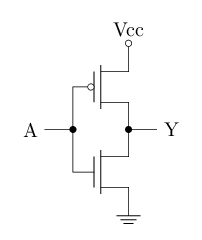

在 Logisim 中搭建并验证两种输入状态下的导通路径：
- **输入为 0**（左图）：pMOS 导通，nMOS 截止，高电平从电源经 pMOS 传至输出端，输出为 1。
- **输入为 1**（右图）：pMOS 截止，nMOS 导通，输出端经由 nMOS 连通至地线，输出为 0。

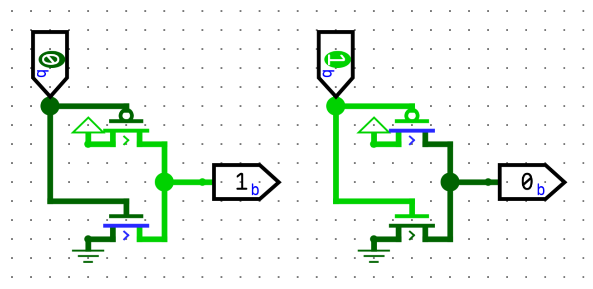

使用 Logisim 窗口顶部的分析电路功能，提取出的真值表：

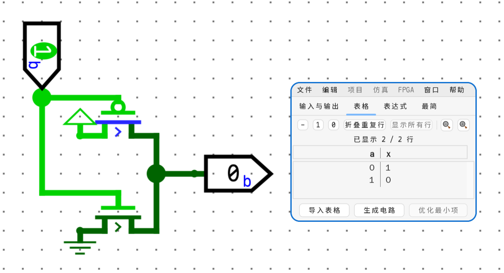

### 2.2 与非门（NAND）与 与门（AND）

在 CMOS 工艺中，反相逻辑（NAND、NOR）比同相逻辑（AND、OR）更容易实现。

与非门（NAND）仅由 4 个晶体管构成：
- **上拉网络**：2 个 pMOS 并联至电源。只要任一输入为 0，上拉通路即导通输出 1。
- **下拉网络**：2 个 nMOS 串联至地线。必须两个输入均为 1，下拉通路才导通输出 0。

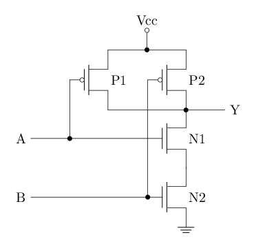

在 Logisim 中搭建与非门并验证真值表：

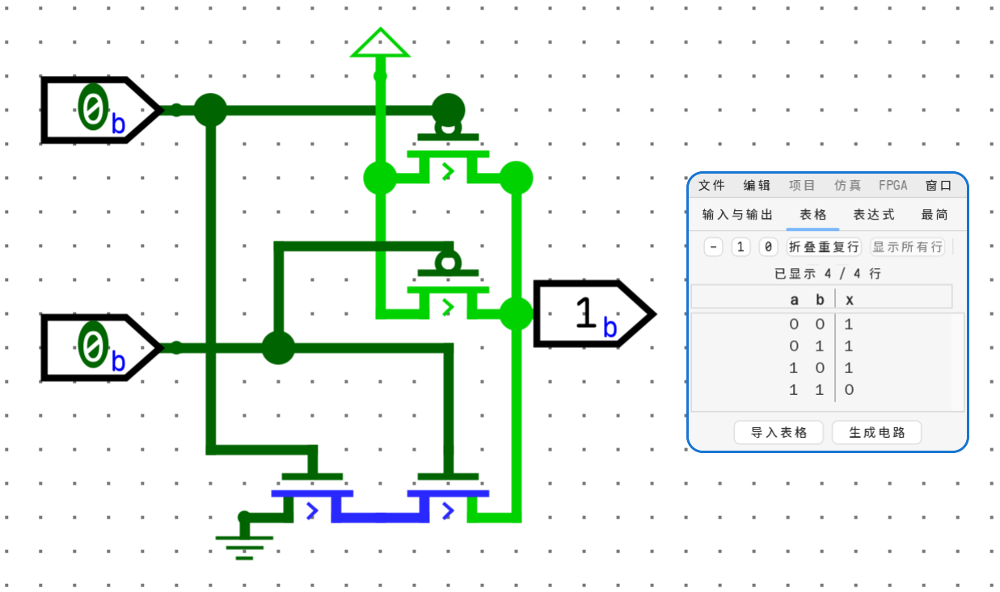

而与门（AND）并非原生 CMOS 结构，它是在与非门的输出端再级联一个由 1 个 pMOS 和 1 个 nMOS 组成的反相器，共需 6 个晶体管：

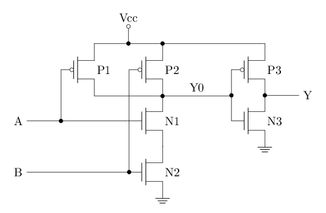

在 Logisim 中搭建与门并验证真值表：

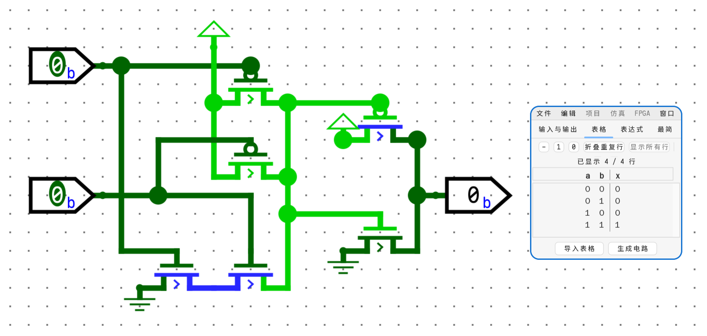

由于与门多了一级反相器，在芯片设计中它的面积大于与非门，并且额外增加了一级门的延迟。

### 2.3 或非门（NOR）与 或门（OR）

或非门（NOR）与与非门的上下拉网络拓扑刚好对偶，同样只需 4 个晶体管：
- **上拉网络**：2 个 pMOS **串联**至电源。必须两个输入均为 0，上拉通路才导通输出 1。
- **下拉网络**：2 个 nMOS **并联**至地线。只要任一输入为 1，下拉通路即导通输出 0。

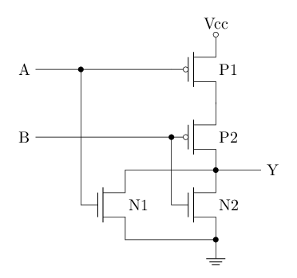

在 Logisim 中搭建或非门并验证真值表：

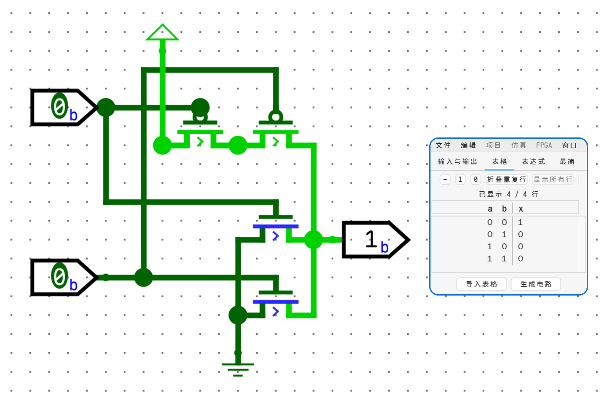

类似地，硬件中没有原生的或门（OR），它是在或非门的输出端级联一个反相器，共需 6 个晶体管：

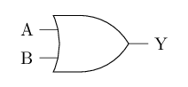

在 Logisim 中搭建或门并验证真值表：

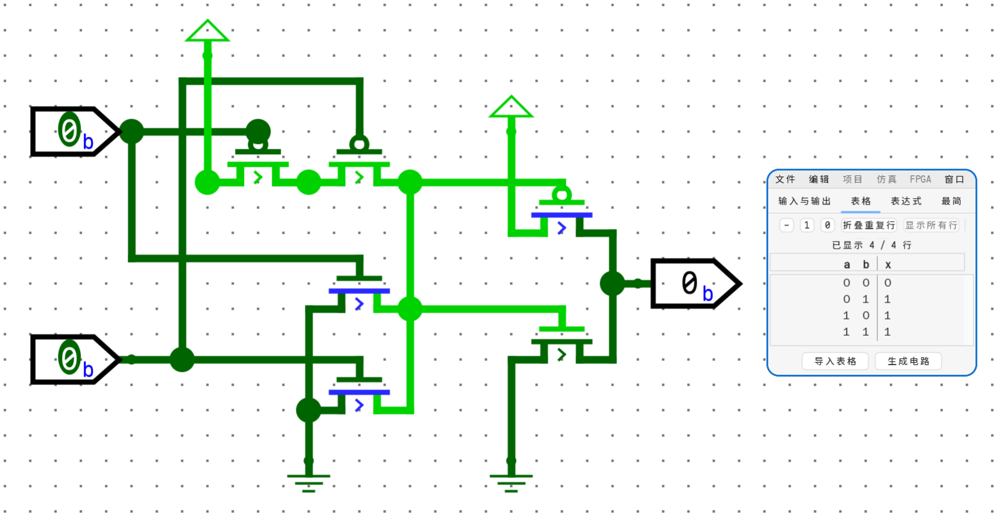

### 2.4 传输门（Transmission Gate）

传输门（Transmission Gate）由 1 个 nMOS 与 1 个 pMOS 并联构成，由一对互补控制信号驱动：

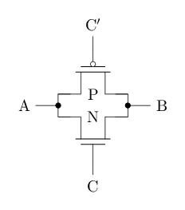

在 Logisim 中搭建传输门并验证其开关特性：

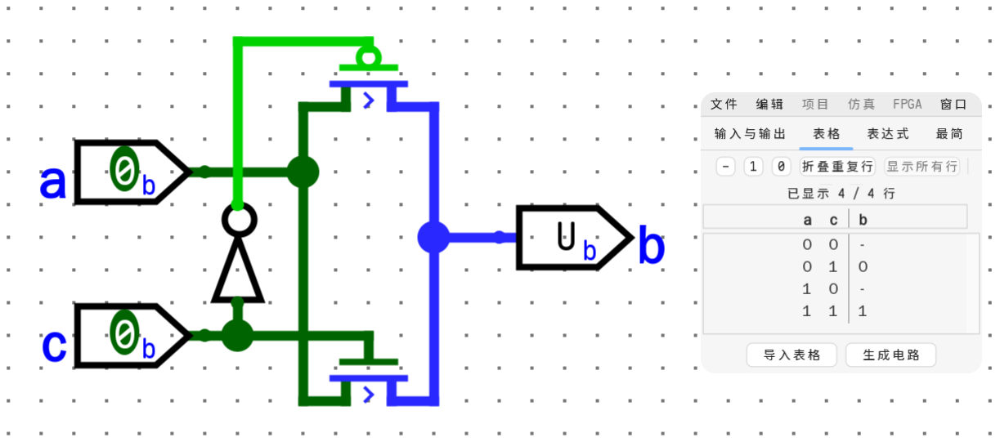

- **控制端 $c = 1$ 时（导通）**：下管 nMOS 栅极接高电平导通，上管 pMOS 栅极接取反后的低电平导通。此时输出端 $b$ 完整跟随输入端 $a$（$a=0 \rightarrow b=0$，$a=1 \rightarrow b=1$），nMOS 负责传递低电平，pMOS 负责传递高电平。
- **控制端 $c = 0$ 时（截止）**：两管均截止，输出端呈现高阻态（真值表显示为 `-`，导线显示为深蓝色悬空状态）。

传输门常用于搭建多路选择器和锁存器，相比使用与或逻辑能显著减少晶体管用量。

### 2.5 异或门（XOR）

异或门（XOR）的逻辑为输入相异输出 1，相同输出 0（$A \oplus B$）。

#### 门电路级实现方案对比（管数从大到小）

1. **标准与或式（22 管）**：  
   根据布尔表达式 $C = (A \cdot \overline{B}) + (\overline{A} \cdot B)$ 直接搭建，由 2 个非门、2 个与门和 1 个或门构成：
   
   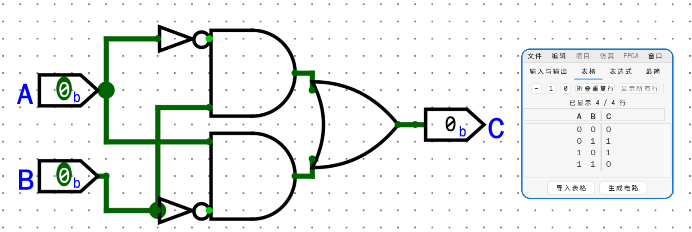
   
   - 晶体管开销：$2 \times 2(\text{NOT}) + 2 \times 6(\text{AND}) + 6(\text{OR}) = 22$ 个晶体管。

2. **OR + NAND + AND 方案（16 管）**：  
   根据“至少有一个为 1，但不能两者同时为 1”的定义：$C = (A + B) \cdot \overline{A \cdot B}$，由 1 个或门、1 个与非门和 1 个与门构成：
   
   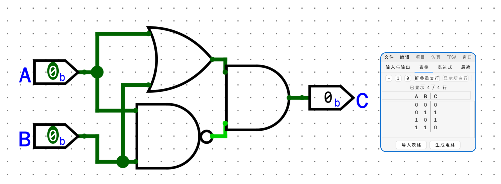
   
   - 晶体管开销：$6(\text{OR}) + 4(\text{NAND}) + 6(\text{AND}) = 16$ 个晶体管。

3. **双 NOR + AND 方案（14 管）**：  
   利用德摩根定律转化：$C = (A + B) \cdot \overline{A \cdot B} = \overline{\overline{A + B} + (A \cdot B)}$，由 2 个或非门和 1 个与门构成：
   
   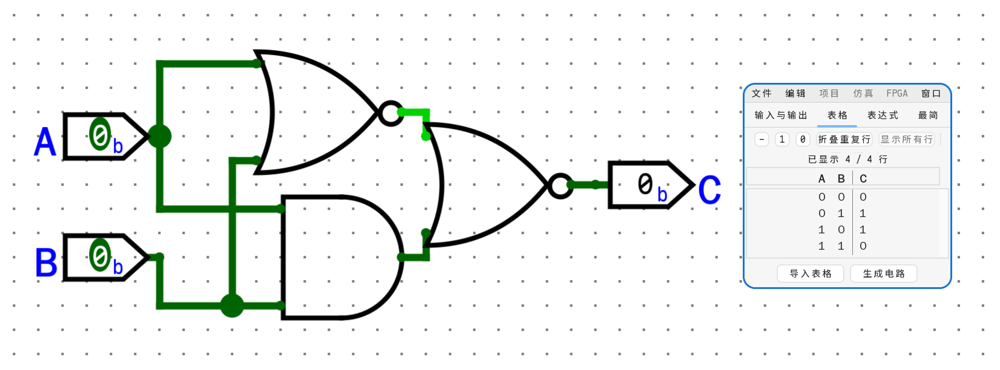
   
   - 晶体管开销：$2 \times 4(\text{NOR}) + 6(\text{AND}) = 14$ 个晶体管。

#### 晶体管级全定制实现（6 管）

在晶体管层次，可以借助反相器和传输门实现极致的面积压缩。经典的全定制拓扑结构如下：

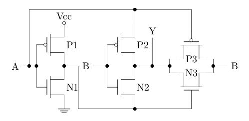

在 Logisim 中搭建并验证该全定制电路：

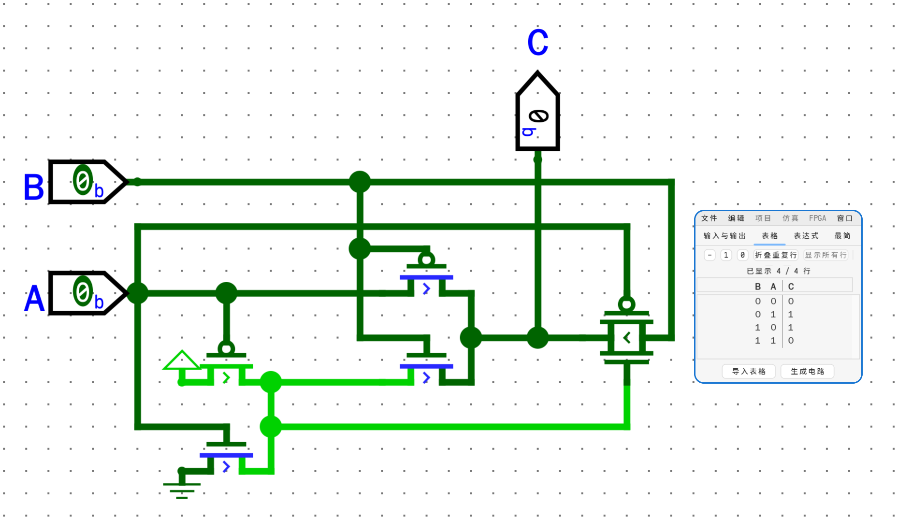

工作原理分析：
- **左侧反相器（P1 + N1）**：输入信号 $A$，产生反相信号 $\overline{A}$。
- **右侧传输门（P3 + N3）**：受 $A$ 与 $\overline{A}$ 控制：
  - 当 $A = 0$（$\overline{A} = 1$）时，传输门导通，直接将输入端 $B$ 传递至输出端 $C$（即 $C = B$）。
  - 当 $A = 1$ 时，传输门截止。
- **中间互补对（P2 + N2）**：受输入 $B$ 控制：
  - 当 $A = 1$ 且 $B = 0$ 时：P2 导通，将 $A$ 的高电平（1）送至输出端 $C$。
  - 当 $A = 1$ 且 $B = 1$ 时：N2 导通，将 $\overline{A}$ 的低电平（0）送至输出端 $C$。
  - 即在 $A = 1$ 时，$C = \overline{B}$。

真值表输出完全符合异或逻辑，而晶体管总数仅为 **6 个**，相比标准门级方案节省了 70% 以上的器件面积。

---

## 3. 门延迟（Propagation Delay）与竞争冒险（Glitch）

在布尔代数中，$A \land \neg A$ 恒等于 0。但在物理电路中，信号经过每个门电路都需要一定的物理响应时间，即传播延迟（Propagation Delay）。

若将信号 $A$ 分为两路接入与门：一路直接相连，另一路经过非门相连。当 $A$ 由 0 跳变为 1 时：
1. 直连路径几乎立即变为 1。
2. 非门路径由于门延迟，输出在极短时间内仍然保持原有的 1。
3. 在此时间窗口内，与门的两个输入同时为 1，导致输出产生一个极短暂的高电平脉冲（$0 \rightarrow 1 \rightarrow 0$）。

这种因路径延迟差异导致的瞬态错误脉冲称为 **Glitch**（竞争冒险）。

在 Logisim 中可以通过单步模式进行观察：
- 按下 `Ctrl+E` 关闭自动仿真，电路状态被冻结。
- 修改输入信号电平。
- 按下 `Ctrl+I` 单步推进一个门延迟时间步，可以观察到信号沿导线逐步推进、Glitch 产生及消除的完整过程。

---

## 4. 组合逻辑电路搭建

### 4.1 2-4 译码器（Decoder）

译码器的作用是将 $n$ 位二进制输入（通常代表地址）转换为 $2^n$ 位独热码（One-hot）输出。输入值为几，对应索引的输出位为 1，其余位全为 0。在处理器架构中，译码器常用于寻址和寄存器选通。

对于 2 位输入 $a[1..0]$ 与 4 位输出 $x[3..0]$，输出每一位的逻辑表达式为：
- $x[0] = \overline{a[1]} \cdot \overline{a[0]}$
- $x[1] = \overline{a[1]} \cdot a[0]$
- $x[2] = a[1] \cdot \overline{a[0]}$
- $x[3] = a[1] \cdot a[0]$

电路需要 2 个非门（4 管）与 4 个两输入与门（24 管），共消耗 28 个晶体管。可以看出，译码器的输出端数量和与门规模随输入位宽呈 $2^n$ 指数增长。

在 Logisim 中使用 `Wiring -> Splitter`（分线器）进行总线分流与汇聚搭建该电路：

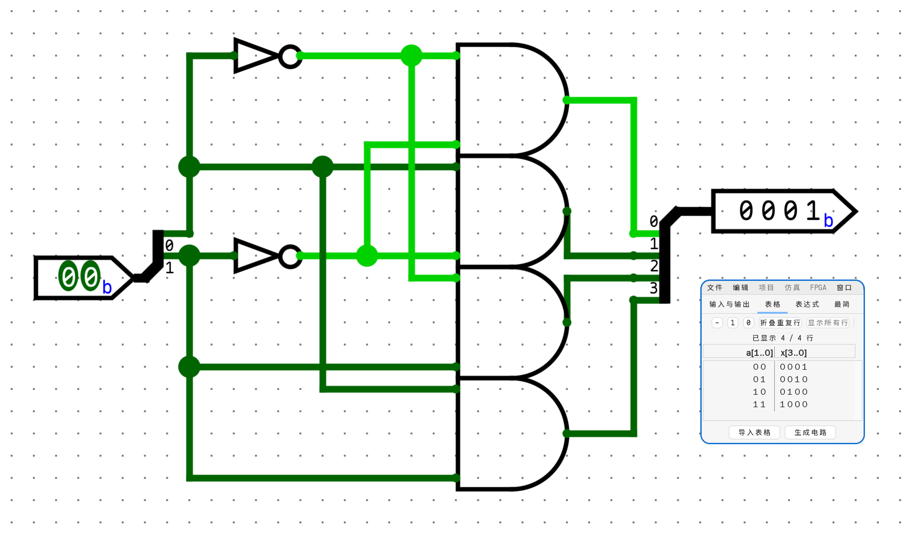

- 输入端通过 `Splitter` 将 2 位总线 $a[1..0]$ 拆解为独立的第 0 位与第 1 位。
- 经过 2 个反相器与 4 个与门生成 4 路单线输出。
- 输出端再次通过 `Splitter` 将 4 路单线重新汇聚为 4 位总线 $x[3..0]$。
- 通过分析电路工具验证，真值表输出严格满足独热码特征（`00->0001`, `01->0010`, `10->0100`, `11->1000`）。

#### 走线优化：配置门电路输入的极性（Negate）
在基础实现中，我们需要在输入端额外放置反相器来拉出反相信号线。在 Logisim 中，逻辑门元件原生支持配置输入端的极性：
- 选中与门，在属性面板中配置对应引脚为取反极性（端点会出现小圆圈）。
- 这样输入母线可以直接直连各与门，省略了外部反相器器件，不仅逻辑等价，画布走线也更加规整清晰：

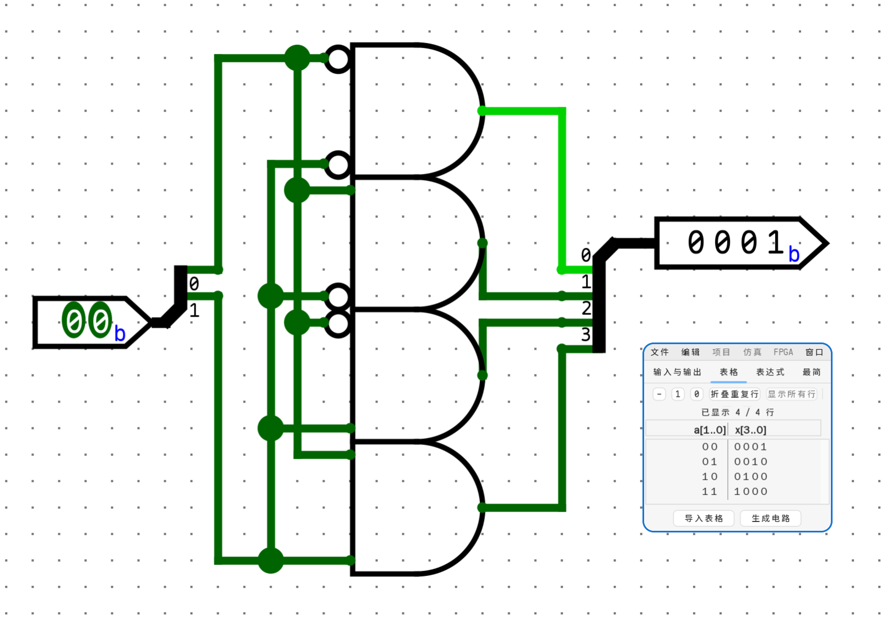

该电路可直接封装为子电路（Subcircuit），作为后续复杂模块的基础单元。

### 4.2 译码器的扩展：从 2-4 到 3-8 译码器

如果要用两个 2-4 译码器级联拼装成 3-8 译码器，必须引入使能端（Enable，`EN`）。否则两个 2-4 译码器同时工作，输出会同时出现两个 1，破坏独热码约束。

#### 带使能控制的 2-4 译码器封装
为了不改动 2-4 译码器内部的与门引脚数，可以利用 Logisim 支持多位宽逻辑门的特性：
- 保持内部原本的 `decoder_2to4` 不变；
- 在 4 位输出总线上串接一个 **4 位宽的与门**；
- 1 位使能信号 `EN` 经由 `Wiring -> Bit Extender`（符号扩展）扩充为 4 位，与译码结果做按位与：
  - `EN = 1` 时：4 位译码结果正常输出；
  - `EN = 0` 时：输出被强制钳位为全 0（禁用）。

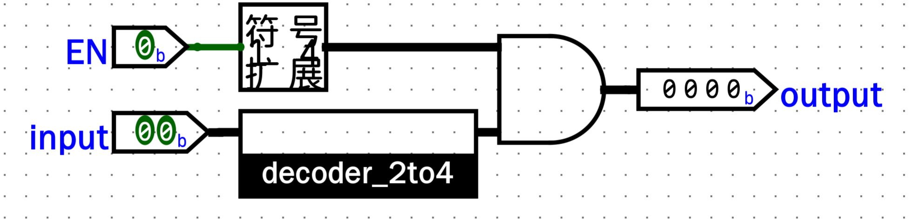

#### 3-8 译码器的级联组装
拥有使能端后，将 3 位输入 $a[2..0]$ 进行分工：
- 低两位 $a[1..0]$ 同时连入两个 `decode_2to4_en` 子模块的输入端；
- 最高位 $a[2]$ 作为片选信号（Chip Select）：反相后接入低位子模块的 `EN`，直连接入高位子模块的 `EN`；
- 两组 4 位输出总线经 `Splitter` 汇聚为 8 位总线 $x[7..0]$。

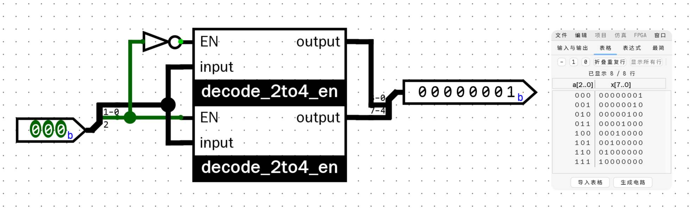

分析电路真值表显示，从 `000` 到 `111`，8 位输出中的 1 从最低位依次移至最高位，完全符合 3-8 独热码规范。

#### 扩展思考：真实 CMOS 芯片中的使能实现（Power Gating）
在上述逻辑设计中，失能是通过与门将输出逻辑电平置 0 来实现的。而在现代集成电路的物理设计中，使能控制还可以进一步下沉到晶体管层面：
- 在下拉 nMOS 网络与地线（GND）之间串联一个共用的总开关管（通常称为 Sleep Transistor 或 Foot Switch）：
  - 当 `EN = 1` 时，总开关闭合，整个模块接地正常工作；
  - 当 `EN = 0` 时，总开关断开，不仅逻辑输出失能，还直接切断了静态漏电通路，达到超低功耗关断（Power Gating）的效果。

### 4.3 七段数码管译码器（7-Segment Decoder）

七段数码管由 7 个条形发光二极管（标记为 a 到 g）按“8”字型排列，另附 1 个小数点发光二极管（h）。七段数码管译码器的功能是将 4 位二进制输入解析为驱动各段亮灭的控制信号。

电路的具体显示规范如下：
- 当输入为 0 到 9 时：正常点亮对应数字，小数点 h 保持熄灭；
- 当输入超出十进制范围（10 到 15 / `0xA` 到 `0xF`）时：显示段 a 到 g 全部熄灭，仅点亮小数点 h。

为了避免直接针对 4 位输入列写庞大复杂的组合逻辑，采用两级架构设计：
1. **第一级**：调用之前封装的 4-16 译码器（`decoder_4to16`），将 4 位输入展开为 16 根独热码信号线（0 到 15）。
2. **第二级**：采用矩阵式（PLA 风格）布线，设置 8 个或门分别对应 a 到 h 共 8 个控制端。各段所需点亮的独热码线引出节点汇入对应或门。

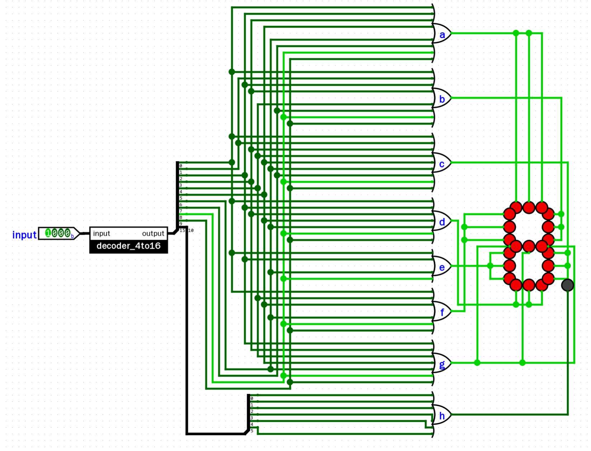

电路验证现象：
- 当前测试输入为 `1000`（十进制 8）时，第 8 根独热码线导通，通过矩阵节点驱动 a 到 g 七个或门全部输出高电平，红色发光管全亮显示出数字“8”，而右下角的小数点 h 保持熄灭。
- 当输入处于 10 到 15 范围时，总线将 10 到 15 六根信号导向底部的 h 或门，输出高电平点亮右下角小数点，满足“超出范围仅显示小数点”的规范要求。

#### 扩展：支持十六进制显示（0 到 F）

讲义随后的任务要求扩展该译码器，使其在输入 10 到 15 时不再仅显示小数点，而是分别显示十六进制字符 `A`、`b`、`C`、`d`、`E`、`F`。为了避免字符形态与数字 `8` 和 `0` 混淆，其中 `B` 与 `D` 约定采用小写形式显示。

在此版本中：
- 移除了仅用于指示超出范围的小数点 h 段，保留 a 到 g 七个主要段；
- 10 到 15 这 6 根独热码线分别接入对应字符所需点亮段的或门：
  - 10（A）：点亮 a, b, c, e, f, g
  - 11（b）：点亮 c, d, e, f, g
  - 12（C）：点亮 a, d, e, f
  - 13（d）：点亮 b, c, d, e, g
  - 14（E）：点亮 a, d, e, f, g
  - 15（F）：点亮 a, e, f, g
- 输出端连接至按标准“8”字形排列的发光组件：

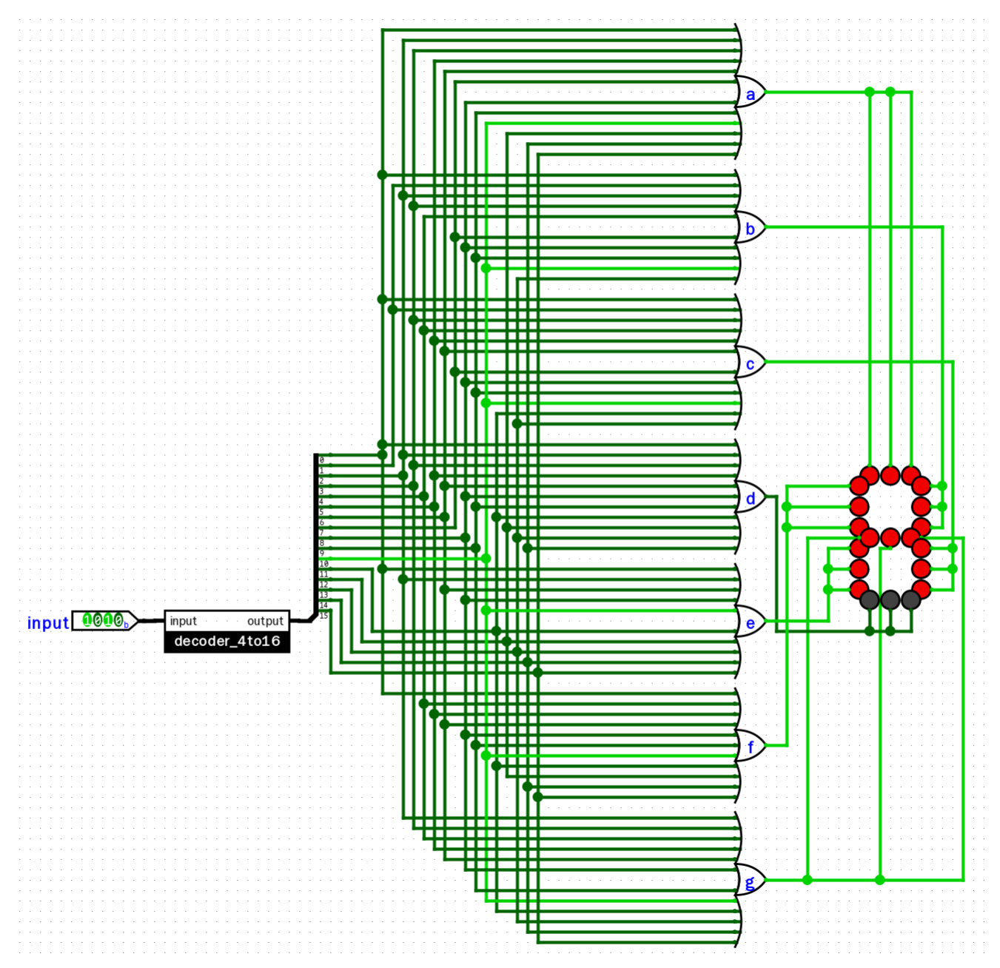

为了版面规整，每个或门的输入端均统一对齐为 16 通道交叉阵列（Crossbar），右侧驱动走线也进行了对称收束。测试输入为 `1010`（十进制 10）时，第 10 根独热码线导通，驱动 a、b、c、e、f、g 段全部点亮，唯独底横 d 段熄灭，在数码管上清晰呈现出大写字母 `A`。当输入切换为其他数值时，十六进制字符亦能准确显示。

### 4.4 编码器（Encoder）与未定义输入处理

编码器是译码器的逆过程，用于将独热码输入还原为对应的二进制数值。例如在 4-2 编码器中，4 位输入 $a[3..0]$ 应对应 2 位输出 $x[1..0]$：
- `0001`（第 0 位有效）输出 `00`
- `0010`（第 1 位有效）输出 `01`
- `0100`（第 2 位有效）输出 `10`
- `1000`（第 3 位有效）输出 `11`

在实际设计中，如何处理非独热码的非法输入决定了硬件开销的巨大差异：

#### 方案一：严格独热码检查（严格与或结构）
为了保证“只有合法的独热码才产生有效编码，其余输入一律置 0”，使用 4 输入与门配合输入端取反极性严格匹配每一路独热码：

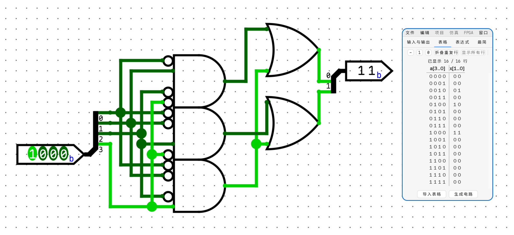

- 现象：只有 `0001`、`0010`、`0100`、`1000` 产生对应的二进制输出，一旦输入包含多个 1（如 `0110`）或全 0，输出全部被与门拦截置为 `00`。
- 开销：需要 3 个四输入与门与 2 个或门，等效晶体管开销达 120 个左右，规模随输入位宽急剧膨胀。

#### 方案二：利用无关项（Don't Care）化简的极简结构
如果引入设计约定——“调用者必须保证输入严格为独热码，其余非法输入视为无关项 X”，布尔逻辑可大幅化简：
- $x[0]$ 只需在第 1 或第 3 位为 1 时拉高：$x[0] = a[1] + a[3]$
- $x[1]$ 只需在第 2 或第 3 位为 1 时拉高：$x[1] = a[2] + a[3]$

此时整个电路仅需 2 个简单的两输入或门：

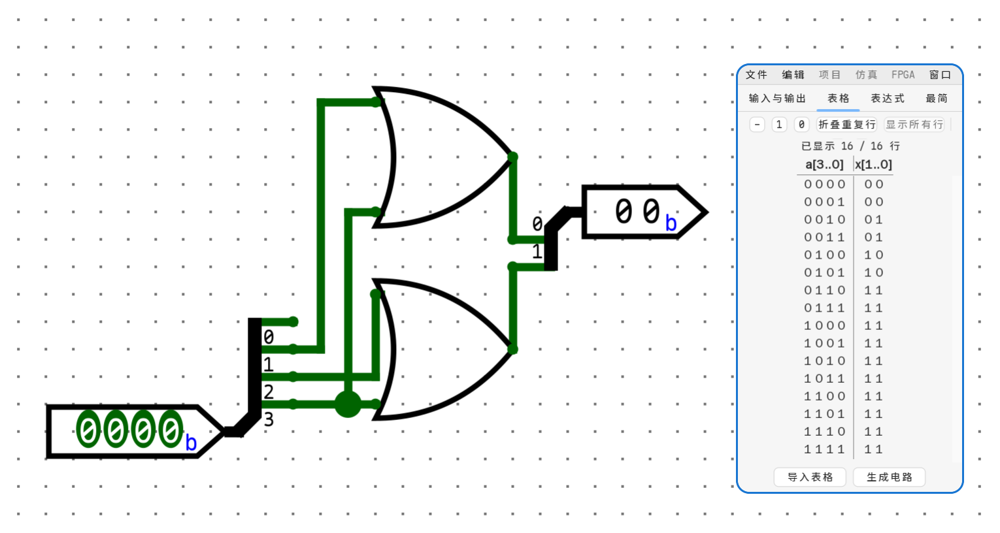

- 现象：在合法独热码输入下功能完全正确，且仅消耗 16 个晶体管（较方案一节省近 90% 面积）。但如果输入出现多路 1（例如按键冲突输入 `0110`），真值表显示输出会被错误计算为 `11`。

这种对非法输入的无能为力，直接促成了优先编码器（Priority Encoder）的诞生：允许输入端同时有多个 1，由硬件按优先级自动裁决并编码最高位的 1。

### 4.5 4-2 优先编码器（Priority Encoder）

优先编码器用于解决多路信号同时触发时的仲裁问题，其规则是：当输入中出现多个 1 时，永远仅对最高有效位（优先级最高）进行编码输出。在计算机体系结构中，该结构是中断控制器（Interrupt Controller）进行多设备请求仲裁的物理基础。

#### 逻辑推导
设定输入 $a[3..0]$ 中 $a[3]$ 拥有最高优先级，$a[0]$ 优先级最低：
- 若最高位 $a[3] = 1$，无论低位为何值，输出必须为 `11`；
- 仅当 $a[3] = 0$ 且 $a[2] = 1$ 时，第 2 位才能胜出输出 `10`（条件项为 $a[2] \cdot \overline{a[3]}$）；
- 仅当 $a[3] = 0$ 且 $a[2] = 0$ 且 $a[1] = 1$ 时，第 1 位才能胜出输出 `01`（条件项为 $a[1] \cdot \overline{a[2]} \cdot \overline{a[3]}$）；
- 若仅 $a[0] = 1$ 或全 0，输出为 `00`。

根据上述条件，输出两位的布尔逻辑为：
- $x[1] = a[3] + (a[2] \cdot \overline{a[3]}) = a[3] + a[2]$
- $x[0] = a[3] + (a[1] \cdot \overline{a[2]} \cdot \overline{a[3]})$

#### 电路搭建与仿真
在 Logisim 中，继续利用输入端取反极性来精简布线：

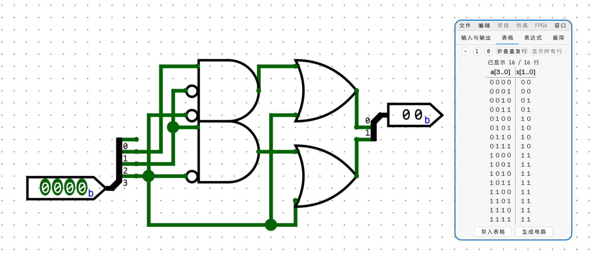

- **电路结构**：仅需 1 个三输入与门、1 个两输入与门和 2 个或门。由于 $a[0]$ 的有效状态对应输出 `00`，且其本身不具备压制任何高位的能力，因此 $a[0]$ 在门级网络中甚至无需物理连线即可满足真值表要求。
- **真值表特征**：右侧分析表格完整展现了优先编码器的阶梯屏蔽效果：只要 $a[3] = 1$（第 8 到 15 行），无论低三位如何组合，输出一律恒为 `11`；当 $a[3] = 0$ 且 $a[2] = 1$（第 4 到 7 行），输出一律恒为 `10`。各输入组合均严格按最高优先级导通。

### 4.6 多路选择器（MUX）

多路选择器是处理器数据通路中核心的控制枢纽，本质是硬件中的条件选择分支。它根据选择端 $S$ 的电平状态，从多路输入数据中择一路由至输出端 $Y$。

以 1 位 2 选 1 选择器（2-1 MUX）为例，其基础功能定义为：
- 当 $S = 0$ 时：输出 $Y = A$
- 当 $S = 1$ 时：输出 $Y = B$

在实现层面，讲义给出了标准门电路与传输门全定制两种方案，两者的器件开销与面积存在显著差距：

#### 方案一：标准门电路实现（与或结构，26 管）

布尔表达式为 $Y = (\overline{S} \cdot A) + (S \cdot B)$。使用 1 个非门生成互补选择信号，分别门控两路数据输入，最后通过或门汇聚：

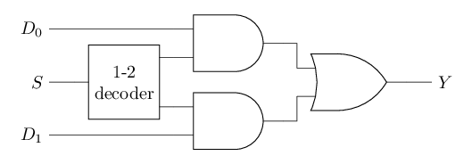

在 Logisim 中搭建并验证：

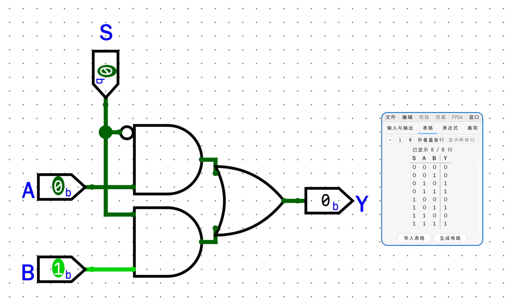

- 硬件开销：包含 1 个非门（2 管）、2 个与门（12 管）和 1 个或门（6 管），等效消耗约 20 到 26 个晶体管。
- 实测真值表：当 $S=0$ 时，前 4 行输出完全跟随输入 $A$；当 $S=1$ 时，后 4 行输出完全跟随输入 $B$。

#### 方案二：传输门全定制实现（仅 6 管）

利用传输门作为双向无损模拟开关的特性，可以直接控制数据路径的物理通断：

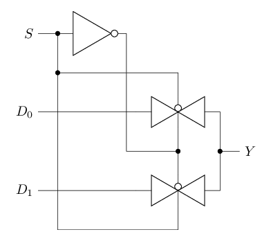

在 Logisim 中搭建并验证：

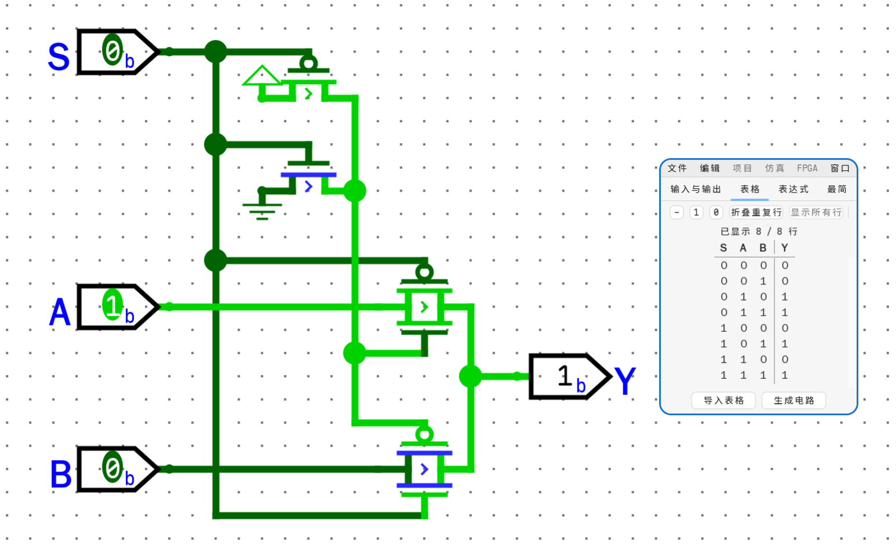

- **工作机制**：
  - 由 1 个反相器将选择信号 $S$ 反相产生 $\overline{S}$；
  - 上方传输门（连接输入 $A$）由 $\overline{S}$ 控制：当 $S=0$（$\overline{S}=1$）时导通，将 $A$ 送至输出端 $Y$；
  - 下方传输门（连接输入 $B$）由 $S$ 控制：当 $S=1$（$\overline{S}=0$）时导通，将 $B$ 送至输出端 $Y$；
  - 两路传输门互斥导通，确保任意时刻仅有一路数据驱动输出端。
- **开销优势**：仅需 1 个反相器（2 管）+ 2 个传输门（4 管）= **共 6 个晶体管**，相比门级方案面积缩小了近 80%，实测真值表与门级方案完全等价。

#### 扩展：3 位 4 选 1 选择器（传输门二叉树拓扑）

在真实的处理器设计中，数据通路通常具有多位位宽（如 8 位、16 位、32 位），并且常需要在多路来源间进行选择（如 ALU 运算源选择、寄存器写回来源选择）。

针对 3 位 4 选 1 选择器，采用两级二叉树结构（MUX Tree）进行搭建：
- **两级二叉树拓扑**：
  - 第一级（左侧）：由低位选择信号 $S[0]$ 及其反相信号并行控制两组 MUX。上半区负责在输入 A（`001`）与输入 B（`010`）之间抉择；下半区负责在输入 C（`110`）与输入 D（`111`）之间抉择，各自输出一组 3 位中间总线。
  - 第二级（右侧）：由高位选择信号 $S[1]$ 及其反相信号控制最终的 MUX，在两组中间总线之间完成最终裁决。
- **总线通道实现**：每一位数据均独立分配一个互补传输门，通过 `Splitter` 进行 3 位总线的分线与汇聚。

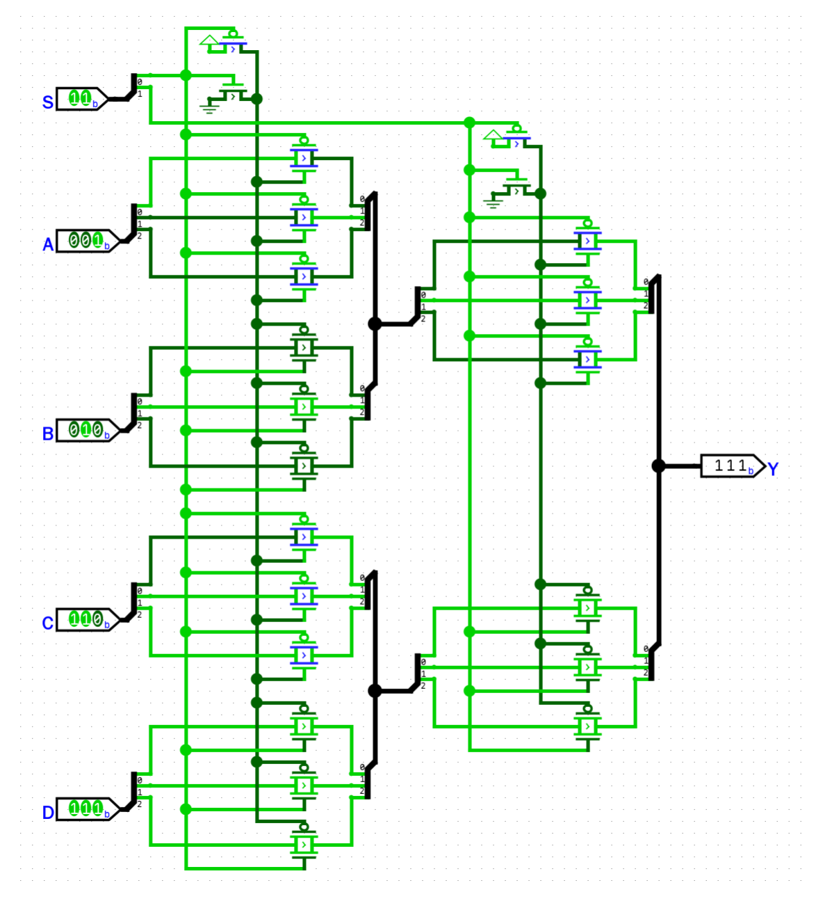

- **硬件开销评估**：整个 3 位 4 选 1 电路仅包含 2 个 CMOS 反相器（4 管）+ 第一级 12 个传输门（24 管）+ 第二级 6 个传输门（12 管）= **仅消耗 40 个晶体管**。若采用门电路方案（2-4 译码器 + 3 组四输入与或门），晶体管开销将超过 130 个。
- **实测验证**：当前选择信号置为 `11`（选择通道 D）：
  - 第一级下半区传输门导通，选出输入 D（`111`）；
  - 第二级下半区传输门导通，将该 3 位数据送至输出端 Y；
  - 最终输出端准确输出 `111`，绿色导通路径完整展示了从输入到输出的物理连通轨迹。

### 4.7 比较器（Comparator）

比较器用于判断两个多位二进制数据是否全等，在处理器体系结构中主要负责条件分支跳转指令（如 RISC-V 的 `beq` / `bne`）的相等性裁决。

#### 逻辑推导与电路拓扑
两数完全相等意味着每一位对应数值完全一致：
- **单比特判等**：使用同或门（XNOR）。当且仅当两位取值相同时（同为 0 或同为 1），输出 1；
- **全等聚合**：将每一位同或门的输出汇总接入一个多输入与门。当且仅当每一位全部匹配时，与门输出 1。

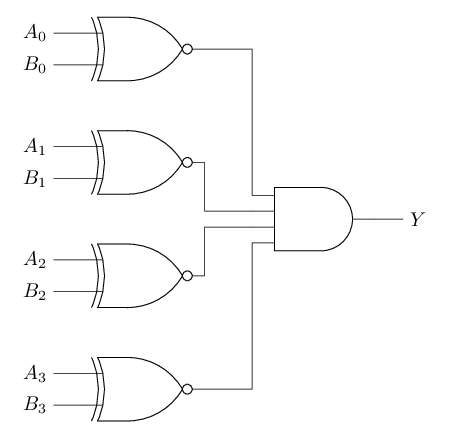

#### 硬件开销评估
- 4 位比较器：4 个同或门（$4 \times 6 = 24$ 管）+ 1 个四输入与门（24 管）= 48 个晶体管；
- 32 位比较器：32 个同或门与 32 输入与门（多级与门级联），开销线性扩展至约 440 个晶体管。

#### Logisim 搭建与仿真

#### 方案一：XNOR + AND 结构（同或逐位判等）

布尔表达式为 $Y = \overline{A_3 \oplus B_3} \cdot \overline{A_2 \oplus B_2} \cdot \overline{A_1 \oplus B_1} \cdot \overline{A_0 \oplus B_0}$：

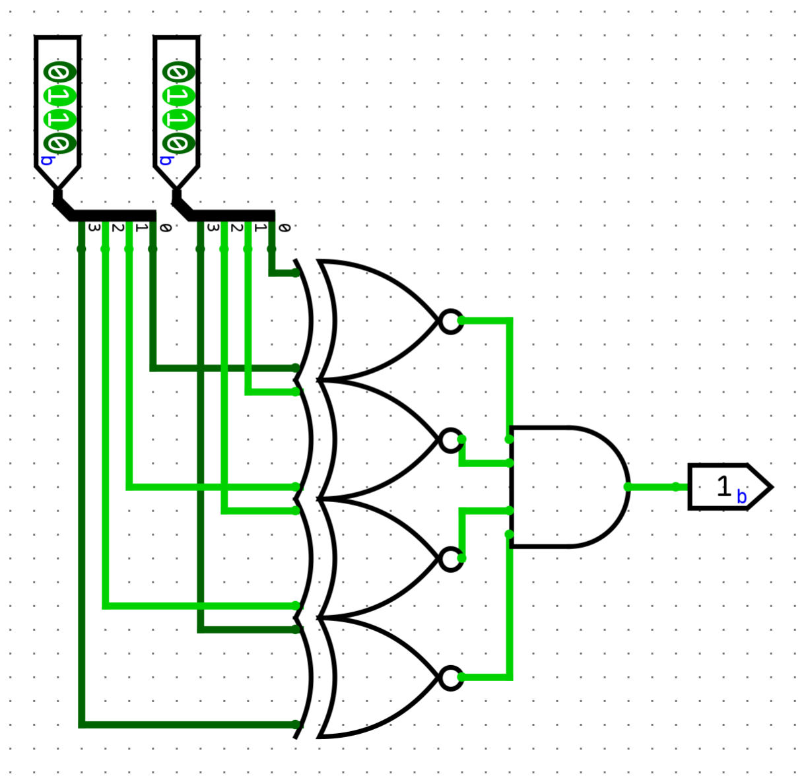

- 两路输入总线经 `Splitter` 分离后，第 0 到 3 位分别接入 4 个 XNOR 门的输入端；
- 测试两组输入均置为 `0110`（十进制 6）：由于各位数值完全相同，4 个 XNOR 输出全部为高电平 1；
- 后级四输入与门导通，输出端准确输出高电平 1。若任意一位出现差异，对应 XNOR 输出跌落为 0，与门即翻转为 0。

#### 方案二：XOR + NOR 结构（异或求异 + 或非归零）

利用德摩根定律，判等逻辑可转化为对偶结构：
$$Y = \overline{(A_3 \oplus B_3) + (A_2 \oplus B_2) + (A_1 \oplus B_1) + (A_0 \oplus B_0)}$$

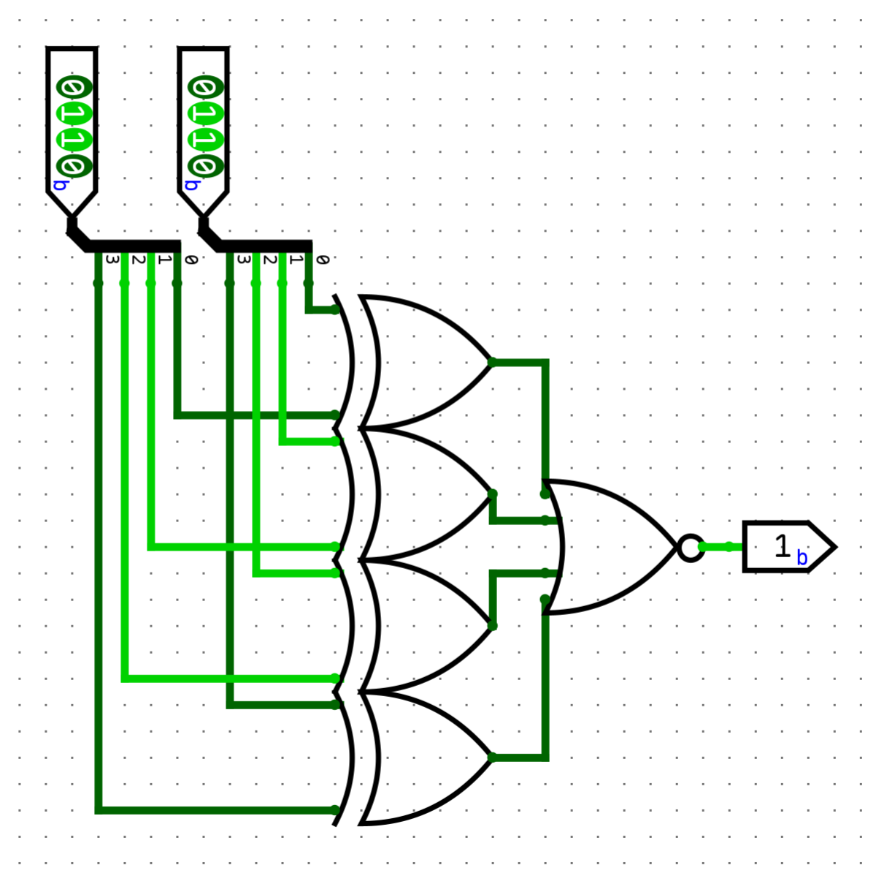

- **工作机制**：前级改用 4 个异或门（XOR）检测差异——若某一位不同则输出 1，完全相同则输出 0；后级接入一个 4 输入或非门（NOR4）。
- **实测验证**：输入同为 `0110` 时，4 个 XOR 门全部输出暗绿色低电平 0；四输入或非门在全 0 输入下输出高电平 1。
- **工艺优势**：在 CMOS 物理设计中，NOR 是原生反相逻辑单元（4 管下拉并联），相比需要后级反相的与门（AND = NAND + NOT），该对偶方案不仅门延迟更小，晶体管开销也更低。

### 4.8 加法器（Adder）：从半加器到全加器

加法是计算机算术逻辑单元（ALU）的基石。在电路实现上，多位加法器由底层的全加器级联构成，而全加器又可由最基础的半加器拼装而成。

#### 1 位半加器（Half Adder）
半加器用于计算两个 1 位二进制数的加法，不考虑低位传入的进位信号。
- **逻辑定义**：
  - 本位和 $S = A \oplus B$（异或运算）
  - 进位输出 $C_{out} = A \cdot B$（与逻辑）
- **电路复用设计**：在具体搭建时，可以直接复用前面方案三的双 NOR + AND 异或门结构。由于该异或结构内部天然包含一个计算 $A \cdot B$ 的与门，因此进位端 $C_{out}$ 可以直接从该与门节点引出，无需额外增加任何门电路器件：

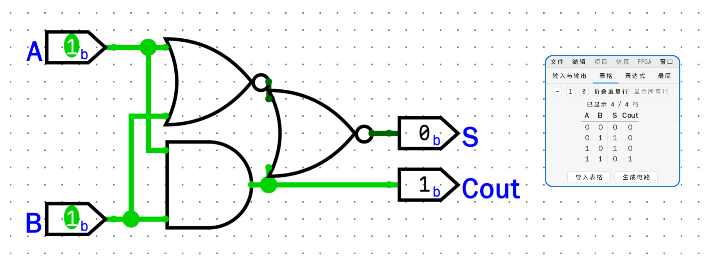

- **实测验证**：当前输入置为 $A=1, B=1$，本位和 $S$ 输出 0，进位端 $C_{out}$ 输出 1，完整代表二进制结果 `10`（十进制 2）。右侧 4 行真值表与算术相加规则完全吻合。

#### 1 位全加器（Full Adder）
全加器引入了低位进位输入 $C_{in}$，用于计算 3 个单比特的算术和（$A + B + C_{in}$），输出本位和 $S$ 与向高位的进位输出 $C_{out}$。

通过级联半加器的方式实现全加器：
- **两级半加器与进位汇聚拓扑**：
  - 第一级半加器完成 $A + B$，输出中间和 $S_0 = A \oplus B$ 与中间进位 $C_0 = A \cdot B$；
  - 第二级半加器接收 $S_0$ 与低位进位输入 $C_{in}$，输出最终本位和 $S = S_0 \oplus C_{in} = A \oplus B \oplus C_{in}$ 与第二级进位 $C_1 = S_0 \cdot C_{in}$；
  - 最终进位输出为 $C_{out} = C_0 + C_1$。由于两级半加器不可能同时产生进位，因此直接使用一个末级或门将两路进位汇聚即可。

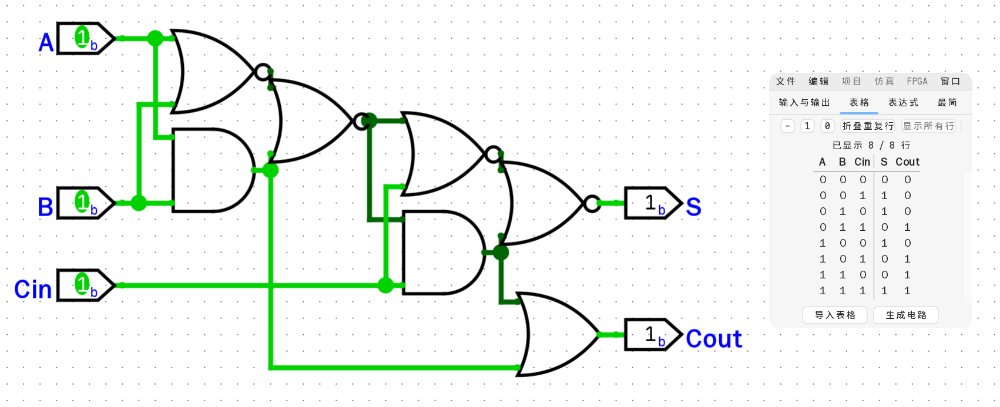

- **实测验证**：当前输入置为三输入全高的极限情况 $A=1, B=1, C_{in}=1$：
  - 第一级半加器输出中间和 0、中间进位 1；
  - 第二级半加器接收中间和 0 与 $C_{in}=1$，输出最终本位和 $S=1$；
  - 末级或门汇聚第一级进位，输出最终进位 $C_{out}=1$；
  - 输出 $S=1, C_{out}=1$，代表二进制数值 `11`（十进制 3）。右侧分析电路导出的 8 行真值表完整满足多位二进制加法进位规则。

---

#### 4 位行波进位加法器（Ripple-Carry Adder, RCA）

为了计算多位二进制加法，将多个 1 位全加器串行级联，低位的进位输出 $C_{out}$ 直接驱动相邻高位的进位输入 $C_{in}$。进位信号如波浪般自最低位向最高位逐级传递，因此称为行波进位加法器（RCA）。

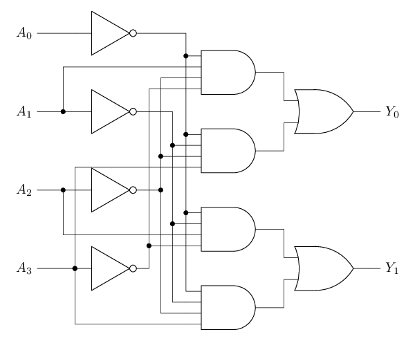

在 Logisim 中实例化 4 个 `full_adder_1bit` 子电路进行搭建：

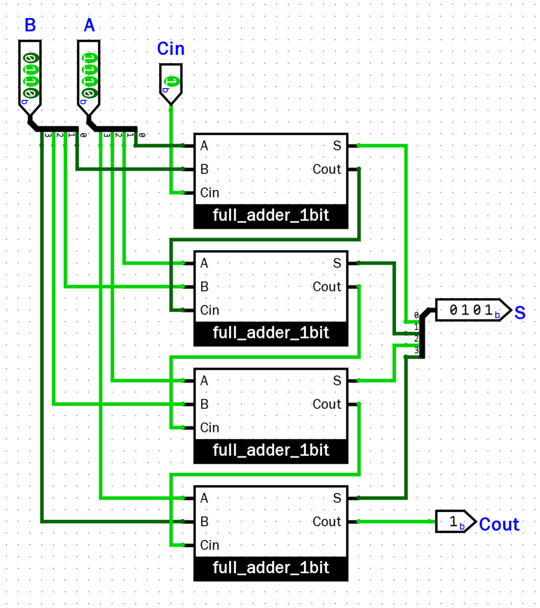

- **电路拓扑**：
  - 两路 4 位输入总线 $A[3..0]$ 与 $B[3..0]$ 经 `Splitter` 拆解为单线，分别送入 4 个全加器对应的 $A$ 与 $B$ 端口；
  - 最低位全加器接收外部进位输入 $C_{in}$；
  - 进位链依次串联：第 0 位 $C_{out} \rightarrow$ 第 1 位 $C_{in} \rightarrow$ 第 2 位 $C_{in} \rightarrow$ 第 3 位 $C_{in}$；
  - 最高位进位输出作为整组加法器的 $C_{out}$，各级全加器的和信号 $S$ 经由右侧 `Splitter` 汇聚为 4 位总线 $S[3..0]$。
- **实测验证**：
  - 测试输入设定为带有进位的典型用例：$A = 1110_b$（十进制 14）、$B = 0110_b$（十进制 6）、$C_{in} = 1_b$（十进制 1）；
  - 理论运算值：$14 + 6 + 1 = 21 = 16 + 5 = 1 \times 2^4 + 0101_b$；
  - 实测输出端：4 位和总线 $S$ 精准输出 `0101`（5），高位进位端 $C_{out}$ 准确输出 `1`（权值为 16），合成结果严格等于 21。
- **性能与时序瓶颈**：
  - 行波进位加法器的关键路径（Critical Path）由进位链决定。当位宽为 $N$ 时，最高位必须等待前 $N-1$ 级进位依次结算完成才能获得稳定输出，运算延迟与位宽成正比（$O(N)$）。在高性能处理器设计中，为了打破该延迟链条，通常会采用超前进位加法器（Carry-Lookahead Adder, CLA）。

### 4.9 补码原理与加减法一体化电路

在计算机硬件设计中，无需为减法单独开辟减法器硬件电路。利用二进制补码的数学性质，减法运算 $A - B$ 可以等价转化为加法：
$$A - B = A + (-B)$$

根据补码定义，负数 $-B$ 的补码表示为其按位取反加 1（即 $-B = \overline{B} + 1$）。代入可得：
$$A - B = A + \overline{B} + 1$$

利用该恒等式，只需在加法器的基础上增加极少控制逻辑，即可实现“加减法一体化”：
- **操作数取反选择**：使用一个多路选择器 MUX（或异或门）受控于模式选择信号 `sub`。当 `sub = 0`（加法模式）时透传原码 $B$；当 `sub = 1`（减法模式）时透传取反后的 $\overline{B}$；
- **末位补 1**：将控制信号 `sub` 直接接入加法器最低位的进位输入端 $C_{in}$。在减法模式下，`sub = 1` 自动将最低位进位拉高，完成最后的 $+1$ 操作。

在 Logisim 中使用 4 位 2-1 MUX 搭建加减法一体化电路：

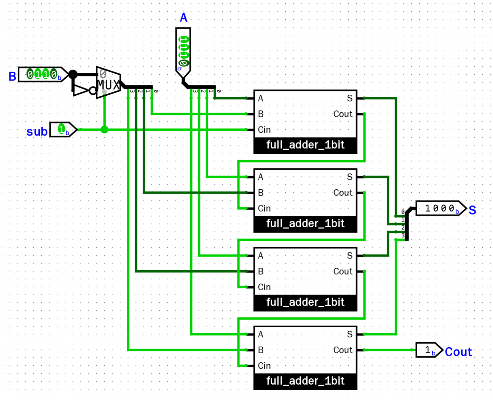

实测减法运算：
- 输入设置：被减数 $A = 1110_b$（十进制 14），减数 $B = 0110_b$（十进制 6），控制信号 `sub = 1`（启动减法模式）；
- 运算推导：
  $$\overline{B} = \overline{0110_b} = 1001_b \quad (9)$$
  $$A + \overline{B} + C_{in} = 14 + 9 + 1 = 24 = 16 + 8$$
  截断第 4 位进位（$C_{out} = 1$，权重为 16）后，低 4 位结果为 8（`1000_b`）；
- 实测输出：和总线 $S$ 精准输出 `1000`（十进制 8），$C_{out}$ 输出 1（在无符号数减法中 $C_{out}=1$ 表示无借位，即 $A \ge B$），完全验证了 $14 - 6 = 8$ 的硬件计算正确性。

### 4.10 补码溢出检测（Overflow Detection）

4 位有符号补码的数值表示范围为 $[-8, +7]$。当运算结果超出该区间时，即发生溢出（Overflow），导致符号位错乱。

#### 数学定义到硬件逻辑的映射推导
数学上判断溢出的规则为“同号相加产生异号结果”（正正得负或负负得正，异号相加绝不溢出）。

若直接根据符号位搭建判断电路：
$$\text{Overflow} = (\overline{A_3} \cdot \overline{B_3} \cdot S_3) + (A_3 \cdot B_3 \cdot \overline{S_3})$$
该逻辑开销较大。而在硬件实现中，考察最高位（符号位）全加器的物理进位关系：
- 本位和：$S_3 = A_3 \oplus B_3 \oplus C_{in3}$
- 进位输出：$C_{out3} = (A_3 \cdot B_3) + (A_3 + B_3) \cdot C_{in3}$

将三类符号输入情况代入分析：
1. **异号相加（$A_3 \neq B_3$）**：此时 $A_3 \cdot B_3 = 0$ 且 $A_3 + B_3 = 1$，代入可得 $C_{out3} = C_{in3}$，恒有 $C_{in3} \oplus C_{out3} = 0$（绝不溢出）；
2. **同为正数（$A_3 = 0, B_3 = 0$）**：进位输出必定 $C_{out3} = 0$，且 $S_3 = C_{in3}$。正正得负的溢出条件为 $S_3 = 1$，即充要条件为 $C_{in3} = 1$。此时 $C_{in3} \neq C_{out3}$；
3. **同为负数（$A_3 = 1, B_3 = 1$）**：进位输出必定 $C_{out3} = 1$，且 $S_3 = C_{in3}$。负负得正的溢出条件为 $S_3 = 0$，即充要条件为 $C_{in3} = 0$。此时 $C_{in3} \neq C_{out3}$。

综合可知，溢出的充分必要条件可极简表示为最高位的进位输入与进位输出异或：
$$\text{Overflow} = C_{in3} \oplus C_{out3}$$

其物理本质在于：$C_{in3}$ 是低位数值区向符号位灌入的进位，而 $C_{out3}$ 是符号位自身向外排出的进位。当两者不一致时（仅进不出或仅出不进），符号位必然被非法改写。

#### 电路搭建与实测

在 4 位加减法器的最高位全加器旁，引出进位输入 $C_{in3}$ 与进位输出 $C_{out3}$ 接入 1 个异或门：

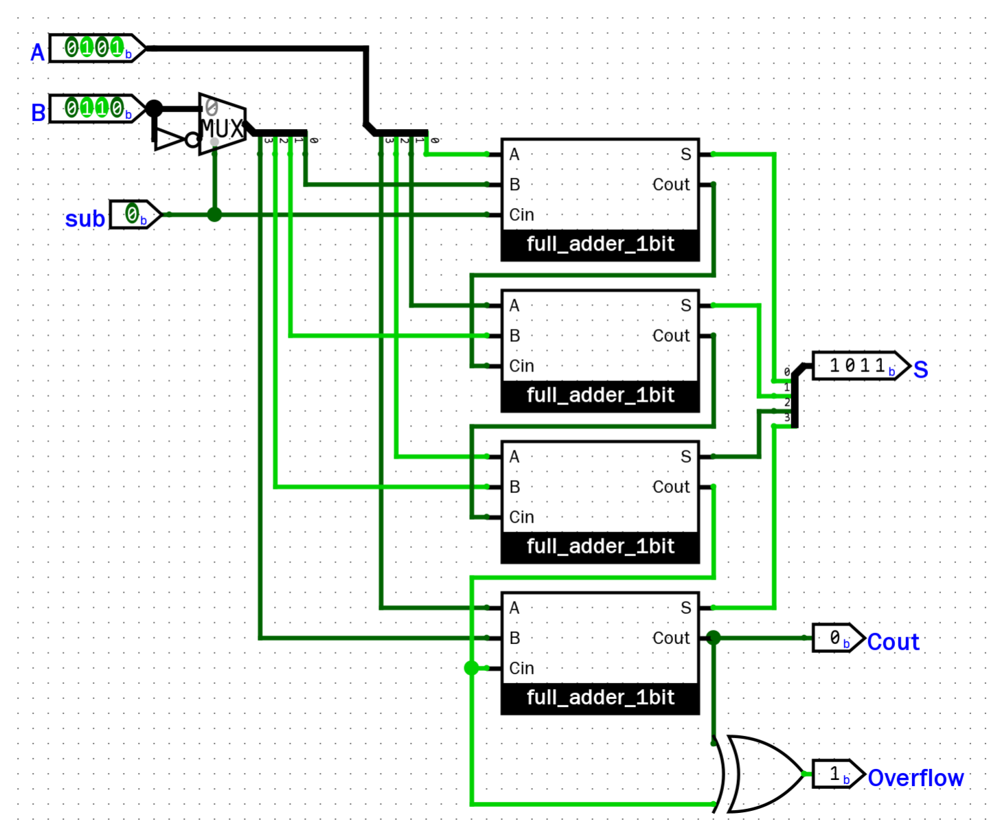

实测用例分析：
- 设定输入：两组 4 位有符号正数加法，$A = 0101_b$（十进制 $+5$），$B = 0110_b$（十进制 $+6$），控制信号 `sub = 0`（加法模式）；
- 理论运算值：$(+5) + (+6) = +11$。由于数值 $+11$ 已经超出了 4 位有符号补码的表示上限 $+7$，必然引发正溢出；
- 实际输出结果：4 位和总线 $S$ 输出 `1011_b`（符号位被错误篡改为 1，在补码中被解释为 $-5$），呈现出“正正得负”的异常；
- 溢出检测逻辑响应：此时低位数值区向符号位灌入进位 $C_{in3} = 1$，而符号位本身并无进位排出（$C_{out3} = 0$）。异或门计算 $1 \oplus 0 = 1$，输出端 `Overflow` 精准输出高电平 `1`，成功捕获并告警了该溢出事件。

---

## 5. 时序逻辑电路与状态存储

组合逻辑电路的输出完全由即时输入决定，不具备任何记忆能力。为了构建能够运行程序的计算机系统，电路必须能够“保持旧状态”并在受控时“写入新状态”。具备状态保持特性的电路称为时序逻辑电路。

### 5.1 状态保持的雏形：正反馈闭环

电路能够“记住”1 位信息的最基础物理拓扑是**交叉配对反相器**：将两个非门首尾相连形成正反馈回路。

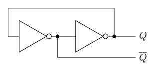

- 若一侧节点为 0，经非门反相后另一侧为 1；该 1 反馈至原节点，继续维持 0；
- 只要持续供电，该闭环即可永久稳定地维持 0 或 1 两种稳态之一。

然而，纯粹的双非门闭环没有任何外部控制输入，外部逻辑无法对其写入新状态。

### 5.2 SR 锁存器（S-R Latch）

为了引入写入控制能力，将闭环中的非门替换为**或非门（NOR）**，并向外引出控制引脚：
- **$S$（Set）**：置位输入端，用于将输出写入 1；
- **$R$（Reset）**：复位输入端，用于将输出清为 0；
- **$Q$ 与 $\overline{Q}$（`nQ`）**：两个互补的输出端。

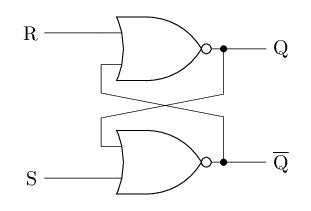

#### 工作状态分析
利用或非门“任一输入为 1 输出即被拉低至 0”的特性，电路行为分为四种状态：
1. **置位（$S=1, R=0$）**：$S=1$ 强制使下方或非门输出 $\overline{Q} = 0$；此时上方或非门两个输入均为 0，输出端 $Q$ 被拉高至 1，完成存入 1；
2. **保持（$S=0, R=0$）**：撤销置位信号回到全 0。此时两个或非门依靠内部正反馈继续维持 $Q=1$ 和 $\overline{Q}=0$，输出端保持上一刻的状态不变，体现出记忆能力；
3. **复位（$S=0, R=1$）**：$R=1$ 强制使上方或非门输出 $Q = 0$；下方或非门两个输入均为 0，输出 $\overline{Q} = 1$，完成存入 0；
4. **禁止状态（$S=1, R=1$）**：两或非门输出同时被强行拉低为 0，破坏了互补关系。若输入随后瞬间跳变回 $00$，两侧竞争将导致电路陷入不可预测的亚稳态或振荡。

#### Logisim 搭建与实测

在 Logisim 中使用 2 个两输入或非门搭建交叉反馈网络：

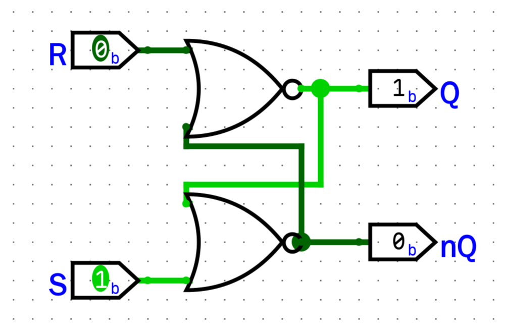

实测验证：
- 当前输入设置为置位状态 $S=1, R=0$：下方或非门被直接激活，输出端 $Q$ 稳定输出高电平 1，反相端 $nQ$ 稳定输出低电平 0；
- 随后将 $S$ 拨回 0（形成 $S=0, R=0$）：电路依然稳固锁存在 $Q=1$，验证了断开激励后电路的状态保持能力；
- 值得注意的是，若使用 Logisim 静态“分析电路”工具，在 $S=0, R=0$ 处会标记冲突错误。这是因为在静态真值表中输出必须是当前输入的确定函数，而时序电路在 $00$ 输入下的输出由“历史状态”决定，纯组合逻辑分析器无法得出唯一值，从工具层面印证了时序记忆特性的物理本质。

### 5.3 D 锁存器（D Latch）

SR 锁存器虽然实现了基本存储功能，但存在两个工程痛点：接口需要同时操作 $S$ 和 $R$ 两个控制端，且误输入 $S=1, R=1$ 会引发非法振荡。

D 锁存器通过在前级增加门控逻辑解决了该问题，将接口精简为两个直观的引脚：
- **数据端 $D$（Data）**：期望存入的数值（0 或 1）；
- **写使能端 $WE$（Write Enable）**：控制是否允许写入。

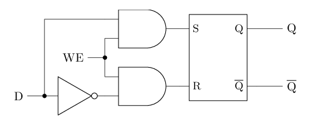

#### 门控逻辑分析
前级由 2 个与门和 1 个非门构成控制通路：
- 数据信号 $D$ 直接接入置位通路的与门，经反相后接入复位通路的与门；
- 写使能信号 $WE$ 同时连接两个与门的使能端。

工作机制分两种工况：
1. **写保护/锁存状态（$WE = 0$）**：两与门输出均被强制钳位为 0（即 $S=0, R=0$）。无论外部输入 $D$ 如何变动，后级 SR 锁存器保持原有状态不变，电路完成数据锁存。
2. **写入状态（$WE = 1$）**：两与门导通，两路信号互补：
   - 当 $D = 1$ 时：$S = 1, R = 0$，后级被置位，输出 $Q$ 翻转为 1；
   - 当 $D = 0$ 时：$S = 0, R = 1$，后级被复位，输出 $Q$ 翻转为 0。
   输出端 $Q$ 实时跟随输入端 $D$（透明传输）。

硬件优势在于：由于置位与复位端分别接收 $D$ 与 $\overline{D}$，在物理结构上完全排除了 $S=1, R=1$ 同时成立的可能，从根本上消除了非法输入风险。

#### 方案一：基于 SR 锁存器的门控实现（30 管）

在 Logisim 中使用已封装的 `SR_latch` 子模块搭建基础 D 锁存器：

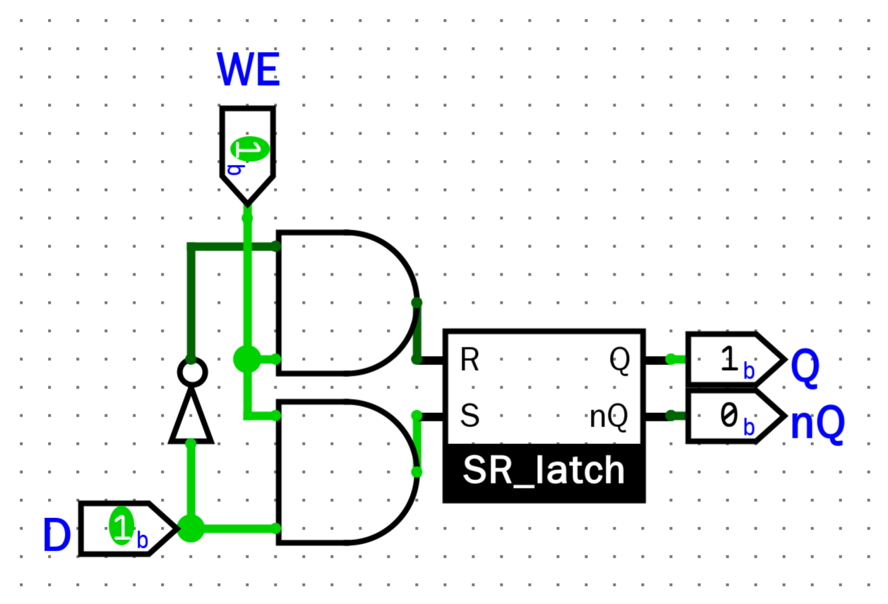

实测验证：
- 当前设置写使能 $WE = 1$（开启写入），数据端输入 $D = 1$；
- 此时上方复位通路输出 0，下方置位通路输出 1，驱动 `SR_latch` 的 $S$ 端置高，输出端 $Q$ 稳定写入高电平 1；
- 一旦将 $WE$ 拨回 0，两路控制线被封死为 00，输出端 $Q$ 即被永久锁定，不再受输入端 $D$ 的后续变动影响。

#### 方案二：传输门全定制实现（仅 10 管）

在芯片物理设计（如 SRAM 缓存单元）中，为了大幅削减晶体管数量，广泛采用传输门（TG）构建全定制 D 锁存器：

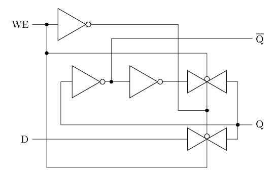

工作机制分析：
- **写入状态（$WE = 1$）**：下方传输门导通，新数据 $D$ 直通内部节点；上方传输门关断，**切断正反馈回路**，避免新旧电平发生短路冲突。此时 $Q = D$，$\overline{Q} = \overline{D}$。
- **锁存状态（$WE = 0$）**：下方传输门关断，切断与外部数据的连接；上方传输门导通，**闭合两个反相器的正反馈回路**，形成双稳态正反馈死循环，牢固锁定数据。
- **开销优势**：仅需 3 个反相器（6 管）+ 2 个传输门（4 管）= **仅消耗 10 个晶体管**，相比门级方案（约 30 管）节省了 66% 以上的芯片面积。

在 Logisim 中搭建并验证该全定制传输门 D 锁存器：

1. **写入 0 状态（$WE = 1, D = 0$）**：

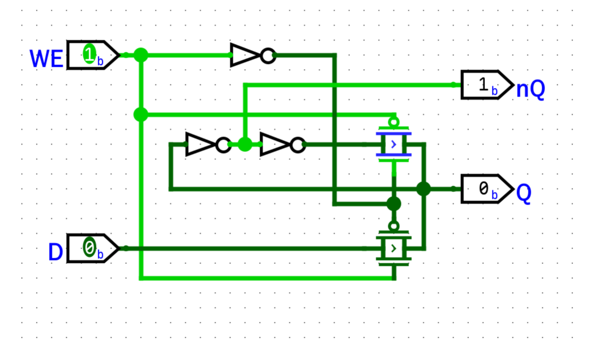

- 下方传输门导通送入低电平，输出端呈现 $Q = 0$、反相端经过一级反相呈现 $nQ = 1$。

2. **写入 1 状态（$WE = 1, D = 1$）**：

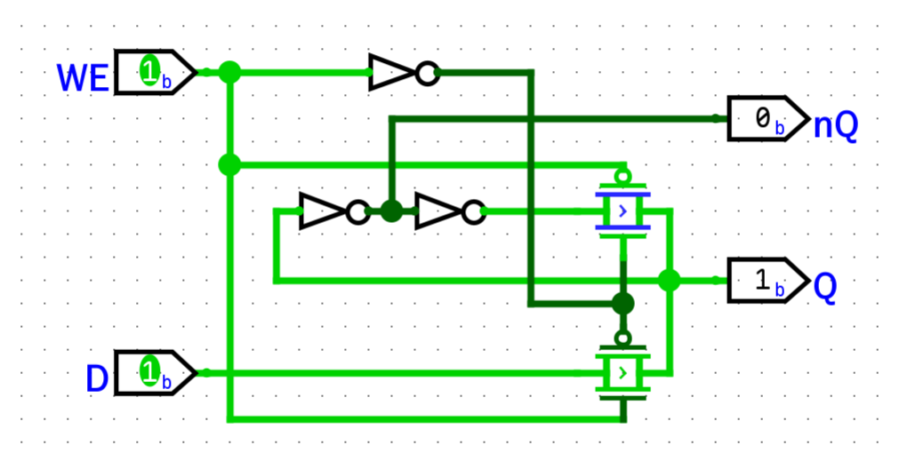

- 下方传输门导通送入高电平，输出端呈现 $Q = 1$、反相端呈现 $nQ = 0$。上方传输门在写入期间保持截止，隔离反馈回路。

#### 电平触发的局限性
D 锁存器属于 **电平触发**（Level-triggered）器件，也被称为透明锁存器。在 $WE = 1$ 保持高电平的整个时间窗口内，数据端到输出端始终处于通路状态。

在 CPU 内部的闭环运算（例如计数器 `A = A + 1`）中，若使用电平触发锁存器，在使能信号维持高电平的微小周期内，数据将在加法器与锁存器之间发生无限次不受控的穿透累加。因此，同步时序系统需要一种仅在“时钟电平跳变的瞬间”进行纳秒/皮秒级快速采样的器件—— **边沿触发的 D 触发器**（D Flip-Flop）。

### 5.4 主从 D 触发器（Master-Slave D Flip-Flop）

为了实现仅在时钟边沿瞬间采样的特性，主从 D 触发器采用两级 D 锁存器串联架构（前级为主锁存器 Master，后级为从锁存器 Slave）：
- 时钟信号 $clk$ 经反相后控制主锁存器的使能端；
- $clk$ 直接控制从锁存器的使能端。

由于两级锁存器的使能极性完全相反，数据通路在任意稳态下均处于截断状态，彻底消除了电平穿透问题。

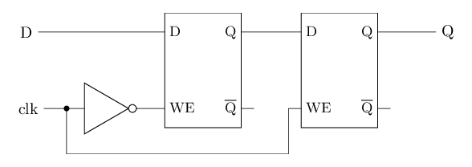

#### 工作时序三阶段分析
1. **数据准备阶段（$clk = 0$）**：主锁存器接收 $\overline{clk} = 1$ 开启大门，数据输入 $D$ 进入主锁存器并抵达两级间的中间节点；而从锁存器接收 $clk = 0$ 保持关闭，数据被阻隔在中间等待区，输出端 $Q$ 保持前一状态不变。
2. **时钟上升沿翻转瞬间（$clk$ 发生 $0 \rightarrow 1$ 跳变）**：主锁存器使能端 $\overline{clk}$ 跌落为 0 瞬间关死落锁，封死外部输入 $D$；同时从锁存器使能端 $clk$ 跃升为 1 打开大门，中间等待区暂存的数据立即被推至输出端 $Q$ 与 $\overline{Q}$。
3. **维持阶段（$clk = 1$）**：主锁存器持续关闭，外部输入 $D$ 的任何变动均无法穿透；从锁存器保持输出稳定。

#### Logisim 搭建与实测

在 Logisim 中使用 2 个 `D_latch` 子模块与 1 个反相器搭建主从 D 触发器，通过两张连续状态截图可以清晰观察到边沿触发的物理演进过程：

1. **时钟低电平准备阶段（$clk = 0$）**：

- 反相器输出高电平驱动主锁存器（$WE = 1$ 导通），输入数据 $D = 1$ 进入主锁存器并输出至两级间的中间节点（绿色高电平线）；
- 从锁存器接收 $clk = 0$ 处于关门锁存状态，阻断数据向外传播，输出端保持历史值（$Q = 0$）。

2. **时钟跳变为高电平更新阶段（$clk = 1$）**：

- 时钟上升沿到来时，主锁存器使能端变为 0 瞬间关闭落锁，阻断外部输入 $D$ 的后续变动；
- 同时从锁存器使能端跃升为 1 开启通道，中间级暂存的数值 1 立即被推入后级，输出端同步翻转更新为 $Q = 1$、$nQ = 0$；
- 在整个 $clk = 1$ 维持阶段，主锁存器持续关闭，外部输入 $D$ 无论如何跳变均无法穿透，彻底实现了边沿触发的时钟同步特性。

#### 扩展功能实现

##### 1. Button 按钮产生时钟脉冲
在 Logisim 中使用 `Wiring -> Button` 元件替代普通开关作为时钟输入，点击一次按钮即可产生一个标准的 $0 \rightarrow 1 \rightarrow 0$ 单脉冲：

按下按钮瞬间产生上升沿，后级从锁存器开启并更新输出；按住按钮不松开期间，前级主锁存器持续锁死，此时变动数据端 $D$ 无法穿透至输出端，直观验证了主从两级的隔离特性。

##### 2. 带同步复位功能的 D 触发器
寄存器在系统初始化时必须具备一键清零能力。在数据输入端 $D$ 串接 1 个两输入与门，另一端接入反相后的复位信号（$D_{in} = D \cdot \overline{rst}$）：

1. **正常工作状态（$rst = 0$）**：

- 当 $rst = 0$ 时，$\overline{rst} = 1$，输入数据 $D = 1$ 原样送入主锁存器，时钟触发后正常写入 $Q = 1$、$nQ = 0$。

2. **复位生效状态（$rst = 1$）**：

- 当 $rst = 1$ 时，$\overline{rst} = 0$，无论外部数据 $D$ 为何值，与门输出均被强制钳位为 0。时钟脉冲到来时，触发器被强制同步清零为 $Q = 0$、$nQ = 1$。

##### 3. 位翻转功能与二分频（Toggle）
将反相输出端 $\overline{Q}$（`nQ`）通过带同步复位的与门反馈回数据输入端 $D$（即 $D_{in} = \overline{Q} \cdot \overline{rst}$）：

该电路构成了二进制计数器与时钟二分频器的核心原子单元：
- 当 $rst = 0$ 时：反相输出直接驱动输入，当前状态为 $Q = 0, nQ = 1$ 时，输入端等待的值为 1；每敲击一次时钟按钮，输出端便稳定翻转一次（$0 \rightarrow 1 \rightarrow 0 \rightarrow 1$），绝不产生电平穿透振荡；
- 当 $rst = 1$ 时：前级与门强制切断反馈输入并写 0，可随时对翻转单元进行同步复位清零。

##### 4. 带使能端的 D 触发器（DFFE）
在实际处理器架构中，寄存器通常只在特定指令执行时才允许更新，绝大多数周期必须保持旧值不变。为了实现该功能，严禁直接在时钟线上串联门电路（门控时钟缺陷会引入严重的毛刺与时钟偏斜），工业界的标准做法是在数据端引入 2-1 MUX 构成反馈选通网络：

- **电路拓扑**：
  - 时钟信号 $clk$ 直连触发器时钟端；
  - 在数据输入端前级配置 1 个 2-1 MUX：通道 1 接收外部新数据 $D$，通道 0 接收输出端 $Q$ 自身的反馈回路，选择端由使能信号 $EN$ 控制。
- **工作机制**：
  - 当 $EN = 1$（使能写入）时：MUX 选通外部数据 $D$，时钟上升沿到来时正常采样并更新数据；
  - 当 $EN = 0$（保持封锁）时：MUX 选通输出端旧值 $Q$ 反馈回输入端。时钟边沿到来时仅对旧值进行重采样，输出 $Q$ 维持恒定不变。
- **实测验证**：当前外部输入设置 $D = 1$，使能端置为 $EN = 0$（禁止写入）。即使时钟跃升为高电平（$clk = 1$），MUX 仍选通上方 $Q = 0$ 的反馈信号送入输入端，输出端稳定锁存在 $Q = 0$，成功拦截了新数据 1 的写入。

### 5.5 寄存器（Register）

单比特 D 触发器仅能暂存 1 bit 信息。在处理器内部，数据均以多位字（Word，如 4 位、8 位、32 位）为单位并行流转，将多个触发器并联组合，共享时钟与控制网络，即构成寄存器（Register）。寄存器是 CPU 通用寄存器组（GPR）与程序计数器（PC）的物理基础。

#### 电路拓扑与控制总线设计
在 Logisim 中使用 4 个内建使能与复位功能的 `D_flipflop_en` 子模块搭建标准 4 位寄存器：

- **总线分流与汇聚**：使用输入端 `Splitter` 将 4 位数据总线 $D[3..0]$ 分解为单比特信号，分别送入 4 个触发器的 $D$ 端口；各触发器的输出端 $Q$ 经由输出端 `Splitter` 重新汇集为 4 位总线 $Q[3..0]$。
- **全局控制信号分发**：
  - 时钟线 `clk` 构成树状直连网络，并行分发至每个触发器的时钟端口；
  - 复位线 `rst` 并行接入每个触发器的复位端，支持同步整字清零；
  - 写使能线 `EN` 并行接入每个触发器的使能端，支持受控整字写入。
- **实测验证**：
  - 输入设置数据总线 $D = 1110_b$（十进制 14），写使能置为 $EN = 1$，复位端保持 $rst = 0$；
  - 时钟脉冲触发后，4 位数据被整齐划一写入各个触发器，输出端总线 $Q$ 稳定输出 `1110_b`；
  - 若将 $EN$ 拨回 0，输出端锁定在 `1110_b`，输入端总线后续变动不再对内部状态产生任何干扰。

### 5.6 4 位计数器（Counter）

计数器是计算机体系结构中第一个具备“自主状态递进”能力的时序系统。在处理器架构中，程序计数器（Program Counter, PC）的顺序取指机制（$\text{PC} = \text{PC} + 1$ 或 $\text{PC} + 4$），本质上即为一个受控自增的计数器。

#### 闭环自增架构设计
将时序存储元件与组合算术运算模块连接为反馈回路：
- **核心模块**：前面封装的 4 位寄存器（`register_4bit`）与 4 位加法器；
- **状态反馈**：寄存器的输出总线 $Q[3..0]$ 一路引向外部显示，另一路送入加法器的输入端 A；加法器输入端 B 连接常数 `0x1`（4 位宽）；
- **数据回灌**：加法器的和输出端（即数值 $Q + 1$）连回寄存器的数据输入总线 $D[3..0]$；
- **控制引脚**：写使能置为 $EN = 1$，复位端保持 $rst = 0$。

在 Logisim 中搭建闭环系统并连接数码管：

1. **计满最大值状态（显示字符 `F`，数值 15）**：

2. **自然回绕重置状态（显示字符 `0`，数值 0）**：

#### 二进制计数与数值解释（无符号数 vs 补码）
4 位二进制在加法器中逐拍递增：
`0000 -> 0001 -> ... -> 0111 (7) -> 1000 (8 / -8) -> ... -> 1111 (15 / -1) -> 0000`
- 加法器硬件本身仅执行纯粹的二进制模运算，不区分有符号或无符号；
- 若通过探针以有符号数格式查看，当计数达到 8 时符号位变为 1，会被显示为负数（$-8$ 到 $-1$）；而在无符号数或十六进制数码管中，则完整展现为连续递增的 `0` 到 `F`（0 到 15）。

#### 实测现象
开启时钟脉冲后，寄存器在每一拍上升沿捕获加法器的计算结果：
- 随着时钟脉冲推进，计数器稳定运行至上限数值 15（`1111_b`），右侧数码管清晰点亮显示出十六进制字符 **`F`**；
- 在下一个时钟周期，加法器执行 $15 + 1 = 16$ 产生高位进位输出 $C_{out} = 1$，4 位和总线低位发生截断重置为 `0000_b` 并写入寄存器，数码管更新显示为 **`0`**，直观验证了硬件计数器自动回绕（Wrap-around）循环运转的特性。

---

### 5.7 专用数列求和电路实战（1 加到 10）

作为数字逻辑基础阶段的综合实践，目标是在不编写任何软件程序的条件下，仅通过门电路、寄存器与算术模块搭建一套专用硬件计算系统，自动完成等差数列累加计算：
$$1 + 2 + 3 + \dots + 10 = 55$$

#### 专用数据通路与控制逻辑设计
该系统由四个核心功能模块紧密咬合构成：
1. **项计数器 $i$（`counter_8bit`）**：由 8 位寄存器与加法器闭环构成，随全局时钟脉冲递增生成当前累加项序列（$1, 2, 3, \dots$）；
2. **累加加法器**：8 位全加器的两路输入分别连接累加寄存器的输出总线 $sum$ 与项计数器的输出总线 $i$，实时计算当前步骤的新累加和（$sum + i$）；
3. **累加寄存器（`register_8bit`）**：负责在每一拍时钟上升沿锁存累加和的新值，并将输出作为下一拍的基数反馈回加法器；
4. **终止判决逻辑（比较器）**：为了防止计数器无限累加，引入比较器将当前项 $i$ 与常数 `0x0b`（十进制 11）进行对比。当 $i < 11$（即 $i \le 10$）时，比较器输出高电平驱动累加寄存器的使能端 $EN = 1$ 进行采样；当 $i$ 达到 11 时，比较器输出拉低关闭写使能 $EN = 0$，将累加寄存器彻底锁死在当前值，实现自动停机。

在 Logisim 中搭建系统并进行运算验证：

#### 实测现象
- 复位后启动仿真，时钟脉冲依次推进：累加项从 1 自增至 10，累加寄存器同步执行 $0 \rightarrow 1 \rightarrow 3 \rightarrow 6 \rightarrow 10 \rightarrow \dots \rightarrow 55$；
- 当计数器达到 11 时，比较器立即拉低写使能 $EN$，累加寄存器停止接收加法器输出，输出端 `sum` 稳固停机并锁定在 **`55_s`**（十进制 55）；
- 该电路通过纯硬件的状态转移、数据反馈与使能门控，完成了完整的循环控制与算术收敛，为后续进入真正的通用处理器（CPU）数据通路设计奠定了坚实的基础。

---

### 5.8 电子时钟系统实战（24 小时制分秒级联走时）

在掌握了单个模 16 计数器与专用累加反馈之后，时序逻辑阶段最综合的硬件工程任务是搭建一套完整的 **24 小时制电子时钟系统**（显示格式：`HH : MM : SS`，范围 `00:00:00` $\sim$ `23:59:59`）。

该系统需要将 6 个十进制/六进制计数单元、6 个七段数码管以及复杂的跨模值回绕逻辑整合成一个高稳定性的同步时序整体。在搭建过程中，必须解决数字系统设计中的三个核心工程挑战：

#### 1. 架构抉择：行波时钟的缺陷与同步使能级联
在早期的简易设计中，常有人将低位计数器的进位脉冲直接接到高位计数器的时钟输入端（`clk`），构成行波时钟（Ripple Clock）。但这种异步设计存在两一致命隐患：
1. **时钟延迟与竞争毛刺**：时钟信号经过各级门电路逐级延迟累积，级联越多时序余量越差，极易在进位瞬间引发高频翻转毛刺；
2. **同步复位瘫痪**：由于高位计数器只有在低位进位的瞬间才有短暂的“时钟沿”，在没有进位脉冲的平时，高位处于时钟静止状态。此时若拉高全局复位端 `rst`，由于缺少时钟触发，高位寄存器根本无法执行同步清零。

**工业级标准的解法是全同步时钟使能（Synchronous Enable）架构**：
- **统一系统时钟**：全系统所有 6 个计数器模块的 `clk` 引脚直接相连，共享唯一的全局主时钟源；
- **全同步复位**：全局 `rst` 广播至所有模块，任何时刻拉高即可整齐划一在一拍内清零；
- **使能链传递进位**：高位是否走步，不由独立的时钟控制，而是由本级的使能输入端 $EN_{in}$ 决定：
  - 只有在输入使能有效（$EN_{in} = 1$）且时钟上升沿到来时，计数器才执行自增；
  - 否则即便时钟持续翻转，寄存器也保持原值不动。

#### 2. 通用模 N 计数单元（`counter_4bit_mod`）的闭环与进位判定
为了驱动各个数码管，需要封装通用的模 $N$ 计数器单元（输入参数包括当前计数上限 `MOD_num`、时钟 `clk`、复位 `rst`、使能输入 `EN_in`；输出当前计数值 $Q[3..0]$ 与进位输出 `EN_out`）。

在设计清零与进位逻辑时，存在一个极具代表性的时序细节陷阱：
- 计数单元内部通过 4 位加法器计算 $Q + 1$，并由比较器比对加法器输出是否达到上限 $\text{MOD\_num}$；
- **错误做法**：若直接将比较器相等信号连回内部寄存器的清零端，当十位计数器计到 5 时（例如秒显示 50 时），加法器预计算值已达到 6，比较器立即输出高电平。这会导致在下一秒个位从 0 变 1 时，十位被提前清零，时间从 `50` 异常跳至 `01`；
- **正确做法**：本级只有在“**正在接收计数使能（$EN_{in} = 1$）**”的前提下，加法器和达到上限才代表真正发生进位溢出。因此必须引入 AND 门汇聚条件：
  $$\text{EN\_out} = (Q + 1 == \text{MOD\_num}) \ \& \ EN_{in}$$
  只有当该逻辑成立时，才向下一级输出进位脉冲，并反馈至当前寄存器的复位端完成本拍清零。

#### 3. 24 小时制跨模值联合判决（`23:59:59` $\rightarrow$ `00:00:00`）
普通的分秒十位是固定的模 6 计数器，但小时是 24 进制：
- 当小时十位为 0 或 1 时，小时个位正常逢 10 进位（09 $\rightarrow$ 10, 19 $\rightarrow$ 20）；
- 当小时十位达到 2 时，个位只要数到 3（即 `23` 点），下一拍就必须与十位同时归零。

若单纯对个位或十位强行清零，会导致 23 点无法正常显示或提前清零。最严密的解法是**联合状态判决**：
引入一个 3 输入与门，同时采集三个前置条件：
1. 小时十位数值等于 2（$H_{\text{十位}} == 2$）；
2. 小时个位数值等于 3（$H_{\text{个位}} == 3$）；
3. 分十位产生进位输出（即整点到来的瞬间：$Carry_{\text{min}} == 1$）。

当三者同时为高电平时，生成跨天清零脉冲 $rst_{24}$。该信号与全局 `rst` 经过或门汇聚后，同时驱动小时十位与小时个位的复位端。

在 Logisim 中搭建完整的 6 位同步走时系统：

#### 实测现象与功能闭环
在 Logisim 中启动自动 Tick 仿真（快捷键 `Ctrl + K`），验证系统在全时段的运行状态：
1. **秒级与分级进位**：
   - 秒个位（模 10）使能端常开，每一拍自增；计满 9 时向秒十位（模 6）输出进位；
   - 秒十位计满 5 且接收进位时，输出满 60 秒脉冲驱动分个位（模 10），秒级在下一拍同步复位为 `00`；
   - 分级同理，稳定实现 60 进位向小时推进；
2. **高位状态保持稳定性（23 点状态检验）**：
   - 如图中实测所示，当前时间运行至 **`23 : 27 : 19`**；
   - 尽管小时十位已处于数值 `2`、个位已处于数值 `3`，但由于分十位未产生进位脉冲，跨天与门输出严密闭锁为 0，小时数码管稳固保持显示 `23`，未发生任何提前误清零；
3. **跨天归零平稳回绕**：
   - 当系统精确递进至 `23 : 59 : 59` 时，跨天判决三条件瞬间全数满足，$rst_{24}$ 输出高电平；
   - 下一时钟沿到来时，全部 6 个数码管同步精准回绕至 **`00 : 00 : 00`**；
4. **一键全局复位验证**：
   - 无论处于任意时段（如 `23:27:19`），手动拨动左上角的全局 `rst` 开关，主时钟沿到来瞬间，6 个数码管整齐划一全部重置归零。

