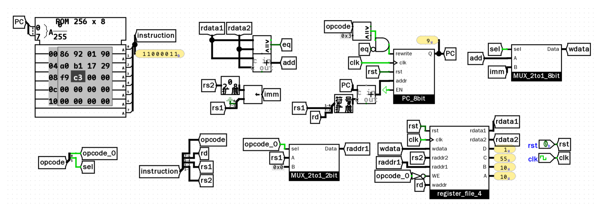

在上一篇数字逻辑基础中，我们搭建了模 16 计数器、专用累加器和 24 小时电子时钟。这些电路虽然能够自动运行，但本质上都是“专用电路”——数据通路和控制逻辑是固定连接的。如果想要改变运算逻辑，就必须调整硬件连线。

本文记录“一生一芯”F4/F5 阶段的核心探索：从计算机系统的状态机模型出发，理解为什么通用计算机只需要改换软件程序就能执行不同任务；随后在 Logisim 中自底向上搭建一颗能执行真实机器码的 8 位通用处理器（sCPU），并完成从绝对跳转到 PC 相对寻址的微架构增强。

## 1. 通用处理器的本质：存储程序与参数化数据通路

专用电路与通用处理器的核心区别在于：

- **专用电路**：运算部件的输入和输出是硬连线的。加法器直接焊死在计数器上，它就只能做累加；焊死在时钟分频器上，它就只能做进位。
- **通用处理器（CPU）**：硬件内部不再固定连接，而是充斥着多路选择器（MUX）与通用寄存器堆（GPR）。每一拍从内存中读出一串固定格式的二进制代码——**指令（Instruction）**。指令的操作码直接作为 MUX 的选择端和寄存器的写使能端，**由软件代码动态决定当前时钟周期硬件数据如何流转**。

这就是“**存储程序（Stored-Program）**”思想：程序本身就是一段预先存放在内存里的指令序列，硬件只需要机械地循环执行三步：
**取指（Fetch）** $\longrightarrow$ **译码（Decode）** $\longrightarrow$ **执行（Execute）** $\longrightarrow$ **更新 PC（Update PC）**

---

## 2. 计算机系统的状态机模型

任何计算机系统都可以抽象为一个状态机四元组：
$$\text{State Machine} = (S, E, f, S_0)$$
- $S$：所有能稳定存储信息的载体的状态组合；
- $E$：驱动系统向前推进的激励事件；
- $f: S \times E \to S$：状态转移规则；
- $S_0$：初始复位状态。

在计算机科学中，高级语言、指令集架构与底层硬件处于同一数学模型的三个层次：

| 层次 | 状态集合 $S$ | 激励事件 $E$ | 状态转移规则 $f$ |
| :--- | :--- | :--- | :--- |
| **1. C 语言程序** | 当前行号 $\text{PC}_{line}$ + 所有变量取值 | 执行一条高级语言语句 | 语言规范定义的语句语义（如 `a = b + 1;`） |
| **2. 指令集架构 (ISA)** | 程序计数器 $\text{PC}$ + 通用寄存器组 $\text{GPR}$ + 内存 | 执行一条二进制机器指令 | ISA 手册定义的指令语义（如 RISC-V / sISA 手册） |
| **3. 数字电路 (CPU 硬件)** | 时序逻辑元件（触发器、寄存器、RAM）的值 | **时钟脉冲上升沿（Clock Tick）** | **组合逻辑电路的真值表（ALU、译码器、MUX）** |

由此，计算机系统中最核心的两项工程活动的本质一目了然：
- **编译（Compilation）**：将“C 语言状态机”翻译成语义等价的“ISA 状态机”（把变量映射到寄存器，把语句映射到指令）；
- **CPU 设计（Architecture）**：用“数字电路状态机”去物理实现“ISA 状态机”（用时序逻辑存状态，用组合逻辑实现指令语义）。

---

## 3. 极简指令集规范（sISA）

为了在硬件中亲手实现上述模型，我们定义一个教学用的极简指令集 sISA：

### 3.1 架构规格
- **程序计数器（PC）**：8 位宽，初始值为 0，理论寻址空间 256 字节；
- **程序存储器（ROM）**：256 单元 $\times$ 8 位宽；
- **通用寄存器组（GPR）**：4 个 8 位寄存器（$r0 \sim r3$），寄存器寻址占用 2 位（`00` $\sim$ `11`）。

### 3.2 8 位定长指令格式
每条指令长 8 位，最高 2 位为操作码（Opcode）：

1. **`add rd, rs1, rs2`（寄存器加法）**：  
   编码格式：`00 | rd[2] | rs1[2] | rs2[2]`  
   语义：$R[rd] = R[rs1] + R[rs2]$

2. **`li rd, imm`（装入立即数）**：  
   编码格式：`10 | rd[2] | imm[4]`  
   语义：$R[rd] = \text{zero\_ext}(imm)$（4 位立即数高位补 0 存入 8 位寄存器）

3. **`bner0 rs2, offset`（不等于 r0 则跳转）**：  
   编码格式：`11 | offset[4] | rs2[2]`  
   语义：若 $R[rs2] \ne R[0]$ 则跳转，否则顺序执行 $PC + 1$。

### 3.3 等差数列求和测试程序（1 加到 10）
通过组合这 3 条指令，完成 $1 + 2 + \dots + 10 = 55$ 的等差数列求和：

```asm
# 地址 : 机器码 : 汇编指令
0 : 0x8a : li r0, 10
1 : 0x90 : li r1, 0
2 : 0xa0 : li r2, 0
3 : 0xb1 : li r3, 1
4 : 0x17 : add r1, r1, r3
5 : 0x29 : add r2, r2, r1
6 : 0xd1 : bner0 r1, 4
7 : 0xdf : bner0 r3, 7
```

---

## 4. sCPU v1 微架构设计（绝对跳转版）

在 Logisim 中搭建 sCPU 时，我们将数据通路解耦为 5 个标准流水级部件：

### 4.1 取指单元（Instruction Fetch, IF）
- 8 位 PC 寄存器驱动 256 字节 ROM 的地址输入端，输出当前指令 `instruction[7..0]`；
- PC 内部默认连接 8 位加法器完成自增步进（$PC + 1$）；当跳转条件满足时，切换为指令中抽取的绝对跳转地址 `addr`。

### 4.2 指令译码单元（Instruction Decode, ID）
- 8 位指令通过分线器拆解为：
  - $Opcode = inst[7:6]$（操作码，2 位）
  - $rd = inst[5:4]$（目标寄存器，2 位）
  - $rs1 = inst[3:2]$（源操作数 1，2 位）
  - $rs2 = inst[1:0]$（源操作数 2，2 位）
- 立即数生成：`rs1` 与 `rs2` 拼接成 4 位立即数，经位扩展器（Bit Extender）高位补零扩展为 8 位立即数 `imm[7..0]`。

### 4.3 通用寄存器堆（Register File, GPR）
寄存器堆需要支持“两读一写（2 Read Ports, 1 Write Port）”：
- **写端口**：由 2-4 译码器根据 `rd[1..0]` 生成 4 路写使能线。写使能总门控设为 $WE = \overline{Opcode[0]}$，确保在执行 `bner0`（`11`）时强制关断写权限；写数据 `wdata` 由 2-1 MUX 在立即数 `imm` 与加法器输出之间选择；
- **读端口 1**：地址 `raddr1` 由 2-1 MUX 控制。执行 `bner0` 时强制选通 `00`（读出 $R[0]$ 用作比较），执行 `add` 时选择 `rs1`；
- **读端口 2**：地址 `raddr2` 直接连入 `rs2`，读出 $R[rs2]$。

### 4.4 执行与跳转判决单元（Execution, EX）
- 8 位加法器计算 $rdata1 + rdata2$，结果送回寄存器写数据 MUX；
- 8 位比较器对比 $rdata1$ 与 $rdata2$ 是否相等，输出 `eq` 信号；
- 跳转判定：当操作码为 `11`（`bner0`）且两数不相等（$\overline{eq} = 1$）时，产生写使能信号 $\text{rewrite} = 1$，将目标地址写入 PC。

在 Logisim 中使用网络隧道（Tunnel）消除跨模块飞线，第一版整机搭建如下：


运行验证显示：四条 `li` 初始化后，PC 在地址 4、5、6 之间循环累加；第 10 次循环结束后，比较器判定 $r1 == r0$，退出循环停机在地址 7，寄存器 $r2$（C 口）输出稳定停留在 **`55_u`**。

---

## 5. 进阶演进：PC 相对分支寻址与符号扩展（sCPU v2）

在第一版 sCPU 中，`bner0` 采用的是**绝对跳转**（即指令中写死目标地址 $PC = addr$）。这种设计存在明显的局限性：
1. **代码不可重定位**：若将这段循环代码复制或平移到内存其他地址，绝对跳转地址将全部失效；
2. **缺乏偏移量复用**：现代主流架构（如 RISC-V 和 ARM）的分支指令几乎均采用 **PC 相对寻址（PC-Relative Addressing）**。

为此，对 sCPU 进行了第二代微架构演进：

### 5.1 符号扩展与相对加法器引入
- **分支偏移量提取**：将指令中的 `rd` 与 `rs1`（共 4 位）提取为相对偏移量 `offset[3..0]`；
- **符号扩展（Sign Extension）**：将 4 位有符号偏移量接入符号扩展器，扩展为 8 位有符号数（补码范围 $-8 \sim +7$）；
- **相对计算**：增加一个 8 位加法器计算跳转目标：
  $$\mathbf{PC_{next} = PC + \text{sign\_ext}(offset)}$$
- 向后循环跳跃时，指令中填入负偏移量（补码）；

### 5.2 立即数移位扩展
在立即数生成路径中引入移位器（Shifter），使 `li` 具备分段移位构造大常数的能力，更贴近现代 RISC-V `lui` 架构。

完成改造后的 sCPU v2 架构图如下：



### 5.3 新版汇编程序与机器码对照（v2 相对寻址增强版）

在引入了 PC 相对寻址与立即数移位扩展后，数列求和程序更新为 10 条机器指令：

```asm
# 地址 : 机器码 : 汇编指令
00 : 0x86 : li r0, 8
01 : 0x92 : li r1, 2
02 : 0x01 : add r0, r0, r1
03 : 0x90 : li r1, 0
04 : 0xa0 : li r2, 0
05 : 0xb1 : li r3, 1
06 : 0x17 : add r1, r1, r3
07 : 0x29 : add r2, r2, r1
08 : 0xf9 : bner0 r1, -2
09 : 0xc3 : bner0 r3, 0
```

### 5.4 运行验证结果
- 初始化执行（PC: 0~5）：各寄存器分别装入初始参数，并完成 $r0 = 10$ 的构建；
- 循环递增执行（PC: 6~8）：通过相对加法器动态计算偏移，稳定完成 10 次累加；
- 最终收敛状态（PC: 9）：
  - **PC 探针**：停在地址 9（探针显示 `9_u`），指令探针显示停机死循环 `11000011_b`（`0xc3`）；
  - **寄存器探针**：
    - `A` ($r0$)：`10_u`（目标值 10）
    - `B` ($r1$)：`10_u`（计数器 $i$ 准确到 10）
    - `C` ($r2$)：**`55_u`**（数列求和结果精确为 55）
    - `D` ($r3$)：`1_u`（步长 1）

至此，整颗 CPU 从单条指令的取指与译码，到完整的两读一写寄存器堆、ALU 闭环、再到现代 PC 相对寻址与符号扩展，全部在数字电路层面上物理实现。
